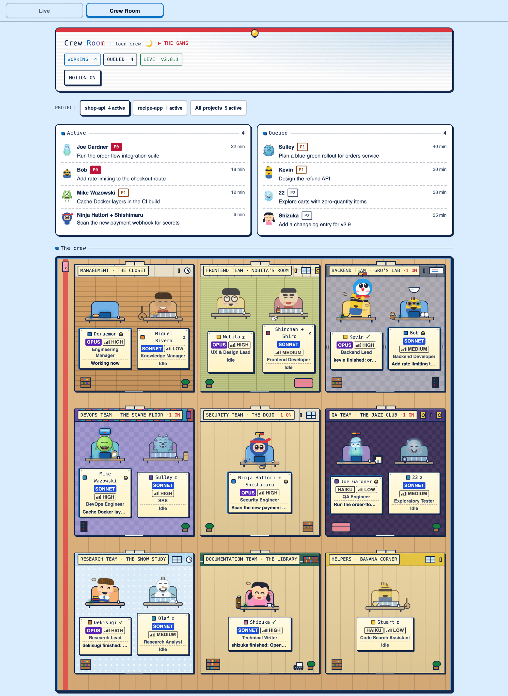
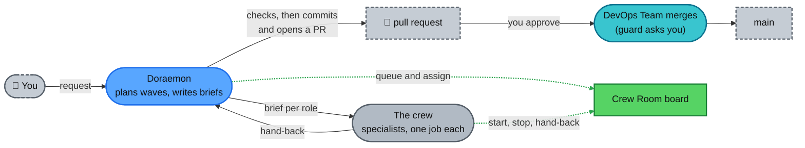

<div align="center">

# toon-crew

**A cartoon crew of 15 Claude Code agents, led by Doraemon, with safety guards and a live Crew Room board.**


[Quick start](#quick-start) · [Commands](#slash-commands) · [The crew](#the-crew) · [How it works](#how-it-works) · [Limits](#limits) · [Learn more](#learn-more)

</div>

<p align="center">
  <picture>
    <source media="(prefers-color-scheme: dark)" srcset="docs/images/crew-room-dark.png">
    
  </picture>
  <br>
  <sub>Crew Room with demo data</sub>
</p>

## Quick start

1. **Install.** In Claude Code, inside any project (this repo is private: `gh auth status` must be green, or an SSH key set up, or the install fails with a clone error):
   ```
   /plugin marketplace add amanpatil808/claude-crew
   /plugin install toon-crew@crew
   ```
   From a shell the same install is `claude plugin marketplace add amanpatil808/claude-crew` and then `claude plugin install toon-crew@crew`.
2. **Reload.** Run `/reload-plugins`, or start a new session. Doraemon is now your main agent.
3. **Open the board.** Run `/toon-crew:board`. It prints `{"pid":..,"port":..,"startedAt":..}`; open `http://127.0.0.1:<port>`. Stop it with `/toon-crew:board stop`.
4. **Ask for work.** Tell Doraemon what you need. On your first real request he writes `.claude/crew/project.md` for the project: read it before you commit it ([first run](docs/setup.md#what-happens-on-first-run)).

## What you get

| The crew | The Crew Room | The guard | Memory |
|---|---|---|---|
| A manager and 14 specialists in nine teams, one job each. | A local page: who is working, what is queued, what was handed back. | A hook that checks risky tool calls. It asks you or blocks. | Each agent keeps lessons for your project in your repo. |

## Slash commands

| Command | What it does |
|---|---|
| `/toon-crew:board [start\|stop\|status]` | Starts, stops or checks the Crew Room page. `start` is the default. You only. |
| `/toon-crew:task add\|start\|done\|drop\|list` | Queues and moves board tasks, e.g. `add --role bob --priority P1 "<text>"`. Doraemon or you. |
| `/toon-crew:project [board\|lessons] [on\|off]` | Shows or flips this project's two opt-in flags (both start off). You only. |
| `/toon-crew:forget [name or path]` | Lists registered projects, or removes one. You only. |
| `/toon-crew:project-profile` | Writes or refreshes `.claude/crew/project.md`. Doraemon, or you. |
| `/toon-crew:crew-lessons` | Collects `[crew]` lessons into one pull request on the crew repo. Repo owner only. |
| `/toon-crew:security-backend` | Checklist for code that holds personal data, logins or secrets. Loaded by the backend and security roles. |
| `/toon-crew:integrations` | Checklist for code that calls a third-party API. Loaded by the backend and security roles. |

## The crew

Tell Doraemon what you need and he picks, or call one directly as `toon-crew:<id>`. Models, colours and what each one does are in [docs/roster.md](docs/roster.md).

| Team | Members |
|---|---|
| Management | Doraemon (manager, main agent), Miguel Rivera |
| Frontend | Nobita, Shinchan |
| Backend | Kevin, Bob |
| DevOps | Mike Wazowski, Sulley |
| Security | Ninja Hattori |
| QA | Joe Gardner, 22 |
| Research | Dekisugi, Olaf |
| Documentation | Shizuka |
| Helpers | Stuart |

## How it works

You talk to Doraemon only. He plans, queues each piece on the board, briefs the right specialist and checks every hand-back. Only he commits; only the DevOps Team merges, after you approve the pull request. Green dotted lines are what the board records.



**Guards.** A hook reads each risky tool call before it runs and answers allow, ask or block; if it cannot decide, it blocks. It is a seatbelt, not a sandbox: keep Claude Code's sandbox on for roles that have Bash. Every rule is in [docs/guards.md](docs/guards.md).

## Limits

- **The guard can be got around** by a determined agent with a shell (for example a script file). Commands you type with `!` skip it.
- **Nobody merges on their own.** Only Mike Wazowski and Sulley may merge, after you approve, and the guard asks each time. The plugin deploys nothing.
- **The board is local and read-only.** It does not start by itself, has no login or buttons, and shows India time (IST) only.
- **Polling is off until you opt a project in** (GitHub through `gh`, one SSH deploy host).
- **Projects never share memory.** Only `[crew]` rules move up, through a pull request the owner merges.
- **Private and unlicensed.** It sends nothing by itself, and uninstalling deletes its data folder. Full list: [docs/faq.md](docs/faq.md).

**Requirements:** Claude Code 2.1.295+, Node 24.2+ and git access to this private repo. Details: [docs/setup.md](docs/setup.md#requirements).

## Learn more

| Doc | What's in it |
|---|---|
| [docs/how-it-works.md](docs/how-it-works.md) | The 16-step flow, where memory lives, several projects |
| [docs/crew-room.md](docs/crew-room.md) | The board: Live tab, diagrams, demo data, troubleshooting |
| [docs/setup.md](docs/setup.md) | Requirements, per-project settings, update, uninstall, develop |
| [docs/faq.md](docs/faq.md) | Everything it does and does not do, and privacy |
| [docs/guards.md](docs/guards.md) | Every guard rule and what it cannot see |
| [docs/roster.md](docs/roster.md) | Every crew member: model, effort, colour |
| [plugin/board/README.md](plugin/board/README.md) | Board API, data folders, task commands, `## Board` keys |
| [CHANGELOG.md](CHANGELOG.md) | What changed in each version |
| [docs/cost-baseline.md](docs/cost-baseline.md) | What it costs to run the crew |
| [plugin/evals/README.md](plugin/evals/README.md), [docs/planning/toon-crew-plan.md](docs/planning/toon-crew-plan.md) | The eval cases; why it was built this way |
