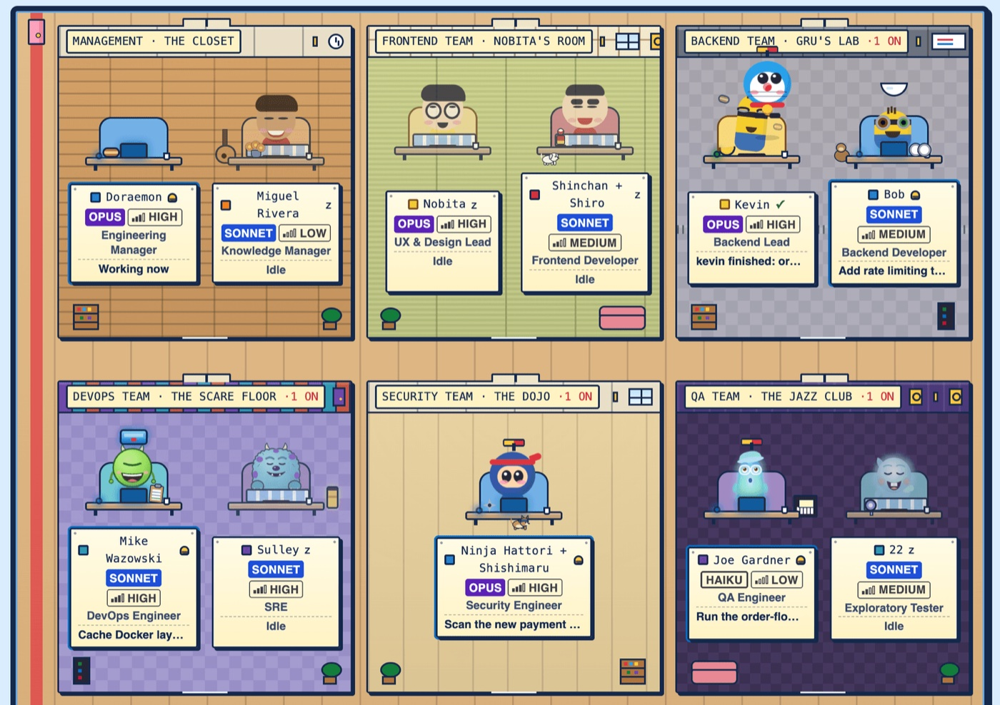
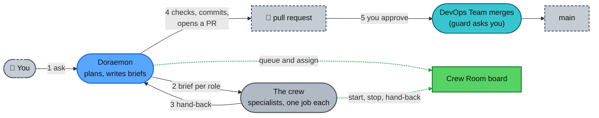

<div align="center">
<h1>toon-crew</h1>
<p><b>Your AI engineering team inside Claude Code: a manager, 14 specialists, and a live board to watch them work.</b><br><br>  </p>
</div>

## Why toon-crew
- **A real team, not one agent.** Doraemon plans the work; 14 specialists each do one job.
- **You stay in control.** Only the DevOps Team merges, after you approve. A guard asks you or blocks risky commands.
- **See everything.** The Crew Room board shows who is working and what is queued.
## Quick start
1. **Install.** In Claude Code, inside any project (this repo is private: `gh auth status` must be green, or an SSH key set up, or the install fails with a clone error):
   ```
   /plugin marketplace add amanpatil808/claude-crew
   /plugin install toon-crew@crew
   /reload-plugins
   ```
2. **Open the board.** Run `/toon-crew:board`. It prints `{"pid":..,"port":..,"startedAt":..}`; open `http://127.0.0.1:<port>`. Stop it with `/toon-crew:board stop`.
3. **Ask Doraemon for anything.** He is now your main agent. On your first request he writes `.claude/crew/project.md`: read it before you commit it.
## Meet the crew
<p align="center"><picture><source media="(prefers-color-scheme: dark)" srcset="docs/images/hero-dark.jpg"></picture><br><sub><b>The Crew Room</b>: the live board that shows your crew at work (demo data)</sub></p>

| Team | Members | What they do |
|---|---|---|
| Management | Doraemon, Miguel Rivera | Plan, brief, commit; keep lessons |
| Frontend | Nobita, Shinchan | Design reviews and screens |
| Backend | Kevin, Bob | Data, logins, APIs, integrations |
| DevOps | Mike Wazowski, Sulley | CI, builds, deploys, merges |
| Security | Ninja Hattori | Attack-style reviews with proof tests |
| QA | Joe Gardner, 22 | Every check, every edge case |
| Research | Dekisugi, Olaf | Cited research and fact-checks |
| Documentation | Shizuka | Docs, release notes, launch copy |
| Helpers | Stuart | Quick code lookups |
## How it works
You talk to Doraemon only. Green dotted lines are what the board records.

1. **You ask** in plain words.
2. **Doraemon plans,** queues each piece on the board and briefs the right specialist.
3. **The crew does the work,** and Doraemon checks every result.
4. **Doraemon opens a pull request.** The DevOps Team merges it after you approve.
## Memory
Plain files, per project. The guard blocks any lesson that looks like a key, token or password.

| What | Where | Who sees it |
|---|---|---|
| Lessons, one file per agent | `.claude/agent-memory/toon-crew-<name>/MEMORY.md` | Your team, once you commit it |
| Project facts | `.claude/crew/project.md` | Your team, once you commit it |
| Event log, project list | The plugin's data folder | Only you, on this machine |
| Shared crew lessons | `docs/lessons/` in this repo | The repo owner, by pull request |
## Commands
| Command | What it does |
|---|---|
| `/toon-crew:board [start\|stop\|status]` | Starts, stops or checks the board |
| `/toon-crew:task add\|start\|done\|drop\|list` | Queues and moves tasks on the board |
| `/toon-crew:project [board\|lessons] [on\|off]` | Allows or stops CI and deploy checks, or the lessons pass (both start off) |
| `/toon-crew:forget [name or path]` | Removes a project from the board's list |

Crew members use the rest automatically; `/toon-crew:crew-lessons` is for the repo owner only.
## Good to know
- **The guard is a seatbelt, not a sandbox.** An agent with a shell can get around it. Keep Claude Code's sandbox on.
- **The board is local only.** It listens on `127.0.0.1`, has no login and no buttons, and shows India time (IST).
- **Requirements:** Claude Code 2.1.295+, Node 24.2+ and git access to this private repo.
- **Private and unlicensed.** It sends nothing by itself.

More: [Setup](docs/setup.md) · [How it works](docs/how-it-works.md) · [Guards](docs/guards.md)
