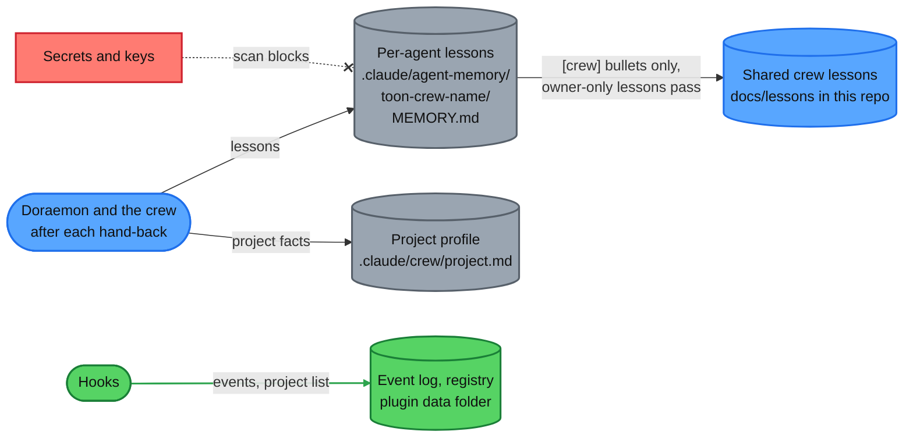

<div align="center">

# toon-crew

**A cartoon crew of 15 Claude Code agents, led by Doraemon, with safety guards and a live Crew Room board.**


[Quick start](#quick-start) · [Commands](#slash-commands) · [The crew](#the-crew) · [How it works](#how-it-works) · [Memory](#where-memory-lives) · [Limits](#limits)

</div>

<p align="center">
  <picture>
    <source media="(prefers-color-scheme: dark)" srcset="docs/images/crew-room-dark.png">
    
  </picture>
</p>

## Why toon-crew?

You talk to one manager; a whole crew does the work, and you can watch and trust it.

| The crew | The Crew Room | The guard | Memory |
|---|---|---|---|
| A manager and 14 specialists in nine teams, one job each. | A local page: who is working, what is queued, what was handed back. | A hook that checks risky tool calls. It asks you or blocks. | Each agent keeps lessons for your project in your repo. |

## Quick start

1. **Install.** In Claude Code, inside any project (this repo is private: `gh auth status` must be green, or an SSH key set up, or the install fails with a clone error):
   ```
   /plugin marketplace add amanpatil808/claude-crew
   /plugin install toon-crew@crew
   ```
   From a shell the same install is `claude plugin marketplace add amanpatil808/claude-crew` and then `claude plugin install toon-crew@crew`.
2. **Reload.** Run `/reload-plugins`, or start a new session. Doraemon is now your main agent.
3. **Open the board.** Run `/toon-crew:board`. It prints `{"pid":..,"port":..,"startedAt":..}`; open `http://127.0.0.1:<port>`. Stop it with `/toon-crew:board stop`.
4. **Ask for work.** Tell Doraemon what you need. On your first real request he writes `.claude/crew/project.md` for the project: read it before you commit it ([first run](docs/setup.md#what-happens-on-first-run)).

## Slash commands

Most of the time you just talk to Doraemon; these are the extras.

| Command | What it does |
|---|---|
| `/toon-crew:board [start\|stop\|status]` | Starts, stops or checks the Crew Room page. `start` is the default. You only. |
| `/toon-crew:task add\|start\|done\|drop\|list` | Queues and moves board tasks, e.g. `add --role bob --priority P1 "<text>"`. Doraemon or you. |
| `/toon-crew:project [board\|lessons] [on\|off]` | Shows or flips this project's two opt-in flags (both start off). You only. |
| `/toon-crew:forget [name or path]` | Lists registered projects, or removes one. You only. |
| `/toon-crew:project-profile` | Writes or refreshes `.claude/crew/project.md`. Doraemon, or you. |
| `/toon-crew:crew-lessons` | Collects `[crew]` lessons into one pull request on the crew repo. Repo owner only. |
| `/toon-crew:security-backend`, `/toon-crew:integrations` | Checklists for code that holds personal data or calls a third-party API. Loaded by the backend and security roles. |

## The crew

Tell Doraemon what you need and he picks, or call one directly as `toon-crew:<id>`. Models, colours and jobs: [docs/roster.md](docs/roster.md).

| Team | Members | Team | Members |
|---|---|---|---|
| Management | Doraemon (manager, main agent), Miguel Rivera | Security | Ninja Hattori |
| Frontend | Nobita, Shinchan | QA | Joe Gardner, 22 |
| Backend | Kevin, Bob | Research | Dekisugi, Olaf |
| DevOps | Mike Wazowski, Sulley | Documentation | Shizuka |
| Helpers | Stuart | | |

## How it works

You talk to Doraemon only. Green dotted lines are what the Crew Room board records.


1. **You ask.** Say what you need in plain words; you never brief anyone else.
2. **Doraemon plans and briefs.** He queues each piece on the board and briefs the right specialist.
3. **The crew builds and checks.** Each specialist does one job and hands back; Doraemon checks every hand-back.
4. **Doraemon commits and opens the PR.** Only he commits. Only the DevOps Team merges, after you approve.

> [!WARNING]
> **Guards.** The guard is a seatbelt, not a sandbox. A hook reads each risky tool call and answers allow, ask or block (if it cannot decide, it blocks). Keep Claude Code's sandbox on for roles that have Bash. Every rule: [docs/guards.md](docs/guards.md).

## Where memory lives

The crew remembers per project, in plain files you can read, edit and commit.



| What | Where | Who sees it |
|---|---|---|
| Lessons for your project, one file per agent | `.claude/agent-memory/toon-crew-<name>/MEMORY.md` in your repo | The agent reads it first; your team sees it once you commit it |
| Project facts: commands, docs per role, no-go areas | `.claude/crew/project.md` in your repo | Every agent reads it first; your team once you commit it |
| Event log and project list | `events.jsonl`, `projects.json` in the plugin data folder | Only you, on this machine, through the board |
| Shared crew lessons | `docs/lessons/` in this repo | The repo owner, who merges the pull request |

> [!NOTE]
> Memory is scanned for secrets. The guard blocks shell writes into agent-memory so the secret scan runs, and rejects Edit or Write calls whose text looks like a key, token, password or other personal data.

## Limits

- **The guard can be got around** by a determined agent with a shell (for example a script file). Commands you type with `!` skip it.
- **Nobody merges on their own.** Only Mike Wazowski and Sulley may merge, after you approve, and the guard asks each time. The plugin deploys nothing.
- **The board is local and read-only.** It does not start by itself, has no login or buttons, and shows India time (IST) only.
- **Polling is off until you opt a project in** (GitHub through `gh`, one SSH deploy host).
- **Projects never share memory.** Only `[crew]` rules move up, through a pull request the owner merges.
- **Private and unlicensed.** It sends nothing by itself, and uninstalling deletes its data folder. Full list: [docs/faq.md](docs/faq.md).
- **Requirements:** Claude Code 2.1.295+, Node 24.2+ and git access to this private repo ([details](docs/setup.md#requirements)).

## Learn more

| Doc | What's in it |
|---|---|
| [docs/how-it-works.md](docs/how-it-works.md) | The 16-step flow, where memory lives, several projects |
| [docs/crew-room.md](docs/crew-room.md) | The board: Live tab, diagrams, demo data, troubleshooting |
| [docs/setup.md](docs/setup.md) | Requirements, per-project settings, update, uninstall, develop |
| [docs/faq.md](docs/faq.md) | Everything it does and does not do, and privacy |
| [docs/guards.md](docs/guards.md) | Every guard rule and what it cannot see |
| [docs/roster.md](docs/roster.md) | Every crew member: model, effort, colour |
| [plugin/board/README.md](plugin/board/README.md) | Board API, data folders, task commands, `## Board` keys |
| [CHANGELOG.md](CHANGELOG.md), [docs/cost-baseline.md](docs/cost-baseline.md) | What changed in each version; what the crew costs to run |
| [plugin/evals/README.md](plugin/evals/README.md), [docs/planning/toon-crew-plan.md](docs/planning/toon-crew-plan.md) | The eval cases; why it was built this way |
