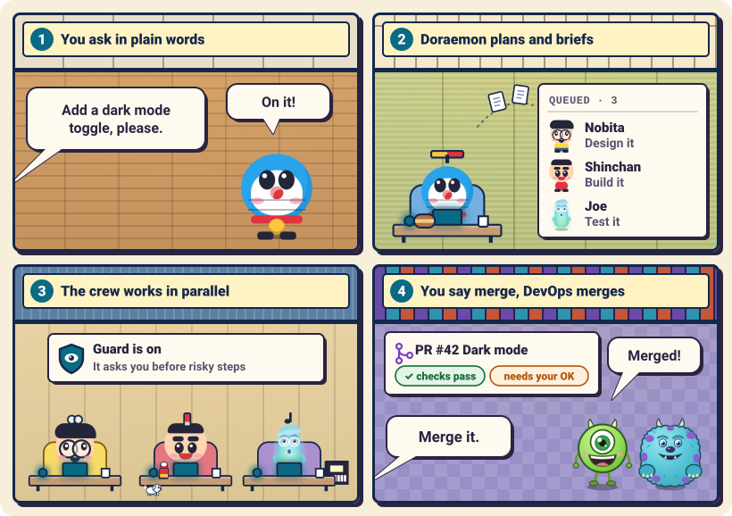
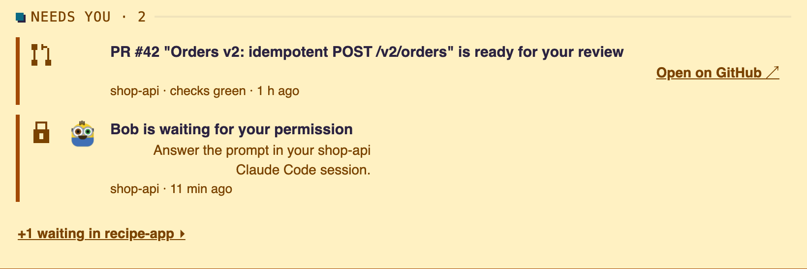

<div align="center">
<h1>toon-crew</h1>
<p><b>Your AI engineering team in Claude Code: one manager, 14 specialists, guards on risky steps.</b></p>
<p>  </p>
<p><code>/plugin marketplace add amanpatil808/claude-crew</code> then <code>/plugin install toon-crew@crew</code> (<a href="#quick-start">steps</a>)</p>
</div>

<p align="center"><picture><source media="(prefers-color-scheme: dark)" srcset="docs/images/architecture-dark.svg"></picture><br><sub>From your ask to a merged pull request: Doraemon plans and briefs, the crew works inside the guard, and every hand-back is checked before a PR.<br>Nothing merges until you approve. The Crew Room board is an optional add-on for watching it live.</sub></p>

## Quick start
In Claude Code, inside any project:

```
/plugin marketplace add amanpatil808/claude-crew
/plugin install toon-crew@crew
/reload-plugins
```

Then ask Doraemon for anything. He is your main agent from now on. On your first request he writes `.claude/crew/project.md`: read it before you commit it.

## What you get
<table>
<tr>
<td width="50%" valign="top">
<picture><source media="(prefers-color-scheme: dark)" srcset="docs/images/card-crew-dark.png"></picture><br>
<b>A crew, not one agent</b><br>
Doraemon plans; 14 specialists each do one job.
</td>
<td width="50%" valign="top">
<picture><source media="(prefers-color-scheme: dark)" srcset="docs/images/card-guard-dark.png"></picture><br>
<b>Guards ask before risky steps</b><br>
Risky commands ask you first; the worst are refused.
</td>
</tr>
<tr>
<td width="50%" valign="top">
<picture><source media="(prefers-color-scheme: dark)" srcset="docs/images/card-plan-dark.png"></picture><br>
<b>An optional live board, plus plan usage</b><br>
Add-on: who works, what is queued, plan usage (Pro or Max).
</td>
<td width="50%" valign="top">
<picture><source media="(prefers-color-scheme: dark)" srcset="docs/images/card-handback-dark.png"></picture><br>
<b>Hand-back files, nothing lost</b><br>
Every crew member leaves a written report you can reread.
</td>
</tr>
</table>

## How it works
<p align="center"><picture><source media="(prefers-color-scheme: dark)" srcset="docs/images/how-it-works-dark.svg"></picture></p>

1. **You ask in plain words.** You talk to Doraemon only.
2. **Doraemon plans and briefs.** He queues each piece on the board and briefs the right specialist.
3. **The crew works in parallel.** Doraemon checks every result; the guard asks you before risky steps.
4. **You say merge, DevOps merges.** Doraemon opens a pull request; Mike or Sulley merges it after you approve.

## Live board (optional add-on)
The crew works fine without it. The board only lets you watch. Run `/toon-crew:board`: it prints a line with a `"port"` number, usually `8811`. Open `http://127.0.0.1:<port>` in your browser, with your port.

<p align="center"><picture><source media="(prefers-color-scheme: dark)" srcset="docs/images/hero-dark.gif"></picture><br><sub>The Crew Room: your crew at work, live (demo data)</sub></p>

<p align="center"><picture><source media="(prefers-color-scheme: dark)" srcset="docs/images/needs-you-dark.png"></picture><br><sub>When the crew needs you, the board says so (demo data)</sub></p>

## Meet the crew
Fifteen crew members in nine teams, one job each. Doraemon is the manager; you talk to him.

<details>
<summary>All 15 crew members</summary>

| Team | Members | What they do |
|---|---|---|
| Management | Doraemon, Miguel Rivera | Plan, brief, commit; keep lessons |
| Frontend | Nobita, Shinchan | Design direction, styles and reviews (Nobita); behaviour and logic (Shinchan) |
| Backend | Kevin, Bob | Data, logins, APIs, integrations |
| DevOps | Mike Wazowski, Sulley | CI, builds, deploys, merges |
| Security | Ninja Hattori | Attack-style reviews with proof tests |
| QA | Joe Gardner, 22 | Every check, every edge case |
| Research | Dekisugi, Olaf | Cited research and fact-checks |
| Documentation | Shizuka | Docs, release notes, launch copy |
| Helpers | Stuart | Quick code lookups |

</details>

## Commands
| Command | What it does |
|---|---|
| `/toon-crew:board [start\|stop\|status]` | Starts, stops or checks the board |
| `/toon-crew:task add\|start\|done\|drop\|list` | Queues and moves tasks on the board |
| `/toon-crew:project [board\|lessons] [on\|off]` | Allows or stops CI and deploy checks, or the lessons pass (both start off) |
| `/toon-crew:forget [name or path]` | Removes a project from the board's list |
| `/toon-crew:handbacks [dir\|list]` | Shows the hand-back folder, or lists the newest summaries |
| `/toon-crew:compact-setup` | Adds editable "Compact instructions" to your CLAUDE.md, after you approve the text |

Crew members use the rest automatically; `/toon-crew:crew-lessons` is for the repo owner only.

## Good to know
- **The guard is a seatbelt, not a sandbox.** An agent with a shell can get around it. Keep Claude Code's sandbox on.
- **The board is local only.** It listens on `127.0.0.1`, has no login and no buttons, and shows India time (IST).
- **Requirements:** Claude Code 2.1.295+ and Node 24.2+.
- **No server.** The plugin sends nothing by itself; GitHub and SSH polling start only if you turn them on.

**Licence:** MIT for the code, see [LICENSE](LICENSE). Character names belong to their owners, see [NOTICE](NOTICE).

[Setup](docs/setup.md) · [How it works](docs/how-it-works.md) · [Guards](docs/guards.md)
