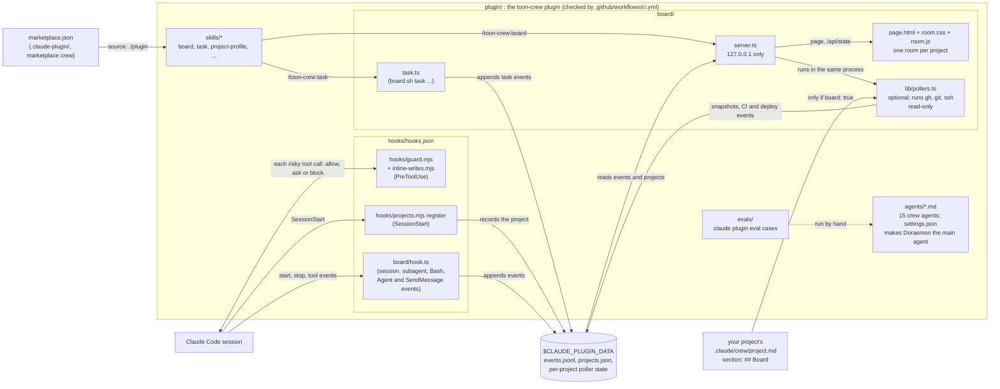
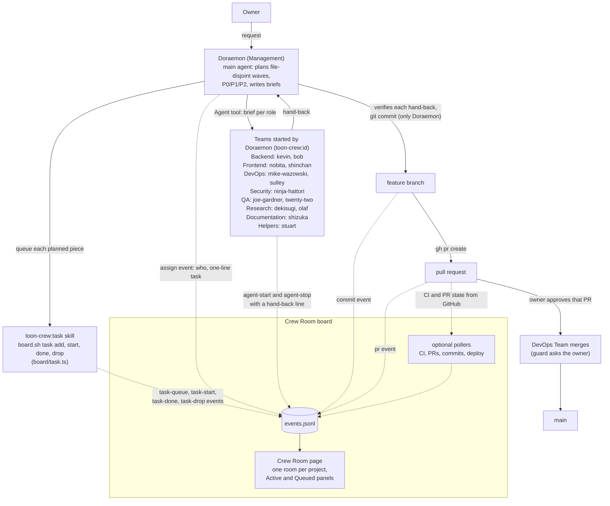

# claude-crew

The `toon-crew` Claude Code plugin: a cartoon agent crew (a manager plus builders, testers, researchers and writers), the Crew Room status board, safety guards, and shared lessons. Private repo, one plugin, one marketplace named `crew`.

## Install

In Claude Code, inside any project:

```
/plugin marketplace add amanpatil808/claude-crew
/plugin install toon-crew@crew
```

From a shell, the same install is `claude plugin marketplace add amanpatil808/claude-crew` then `claude plugin install toon-crew@crew`. The repo is private, so git must already be able to read it (`gh auth status` is green, or an SSH key is set up).

Needs Claude Code 2.1.295 or later: the guard hook uses `"onFailure": "block"`, which older versions don't support.

## How it works

Two pictures: what is in the plugin and how data moves between its parts, then what happens to a piece of work from your request to a merged pull request. [docs/how-it-works.md](docs/how-it-works.md) has the longer version: the 16-step flow, roles, where memory lives, several projects, and the board's tabs and task panels.

### How the parts fit together



Claude Code loads the plugin from the marketplace, makes Doraemon the main agent, and runs the hooks around every session. The guard hook checks each risky tool call before it runs. The other hooks only write: a project list and a one-line-per-event log in the plugin's data folder. The `task` skill writes to the same log: Doraemon uses it to queue, start, finish or drop board tasks.

The Crew Room board is a separate local page. `board.sh start` runs `server.ts` on `127.0.0.1`; it reads the log and serves the page, which shows one room per project. Only if you opt a project in (`"board": true` in `projects.json`) and the project's `project.md` has a `## Board` section does it also poll GitHub CI, pull requests, commits and a deploy host, read-only. CI (`.github/workflows/ci.yml`) runs the structure check, strict validation, the hook and board tests and gitleaks on the plugin. Evals are run by hand; CI does not run them.

### How the crew works a task



You talk to Doraemon only. He splits the work into waves, queues each piece on the board, starts the right team for each piece, reads what each one hands back, and does the checking and the commits himself. Only Doraemon commits and starts crew members (Dekisugi may hand a narrow question to Olaf or Stuart), and only the DevOps Team merges, after you approve that pull request.

The board watches through hooks. A queued task sits in the Queued panel. When Doraemon assigns that role, the oldest queued task for it becomes active (an assignment with nothing queued becomes an active task itself), and it is done when its agent stops, with the agent's one-line hand-back. A task nobody has touched for six hours is shown as done. A desk shows as working while the project has an active task for that role or the agent is running. Commits and pull requests that run through a Claude session show up as events too; the optional pollers add CI, pull request and commit changes that happened elsewhere.

## Update

`version` in `.claude-plugin/plugin.json` pins each project to a release, so nothing changes until you ask:

```
/plugin marketplace update crew
/plugin update toon-crew@crew
```

Then `/reload-plugins`. Read `CHANGELOG.md` first.

## Per-project setup

The plugin sets the main agent to Doraemon (`"agent": "toon-crew:doraemon"` in its `settings.json`). A user's own `agent` setting overrides it.

Plugin settings can only set `agent` and `subagentStatusLine`; Claude Code drops every other key. So anything else goes in each project's own `.claude/settings.json`:

```json
{
  "worktree": { "baseRef": "head" },
  "env": { "CLAUDE_CODE_SUBAGENT_MODEL": "sonnet" }
}
```

- `worktree.baseRef: head` (recommended): builders that work in their own worktree (kevin, bob, shinchan, mike-wazowski, sulley) start from your working branch, not the default branch.
- `CLAUDE_CODE_SUBAGENT_MODEL` (optional): this does **not** make the crew cheaper. Claude Code picks a subagent's model in this order: the `model` passed on the call, then the agent file's `model`, then this variable, then the main session's model. Every crew agent sets its own `model`, so the variable only reaches agents without one, such as the built-in general-purpose agent. For those, it stops them from running on the main session's model (often Opus).
- Don't set `CLAUDE_CODE_SUBAGENT_MODEL_FORCE`. It makes Claude Code ignore every agent file's `model` and every per-call model, so it would quietly move every crew role onto one model.

The guards block Claude from editing `.claude/settings*.json`, so make these edits yourself.

Optional, your choice: `/model opusplan` runs the main session on Opus in plan mode and on Sonnet the rest of the time.

## The crew

Fifteen agents in nine teams. Call them as `toon-crew:<id>`; full details (models, colours, rooms, retired characters) are in [docs/roster.md](docs/roster.md).

| Team | Who (id) |
|---|---|
| Management | Doraemon, Engineering Manager (`doraemon`); Miguel Rivera, Knowledge Manager (`miguel-rivera`) |
| Frontend Team | Nobita, UX & Design Lead (`nobita`); Shinchan, Frontend Developer (`shinchan`) |
| Backend Team | Kevin, Backend Lead (`kevin`); Bob, Backend Developer (`bob`) |
| DevOps Team | Mike Wazowski, DevOps Engineer (`mike-wazowski`); Sulley, SRE (`sulley`) |
| Security Team | Ninja Hattori, Security Engineer (`ninja-hattori`) |
| QA Team | Joe Gardner, QA Engineer (`joe-gardner`); 22, Exploratory Tester (`twenty-two`) |
| Research Team | Dekisugi, Research Lead (`dekisugi`); Olaf, Research Analyst (`olaf`) |
| Documentation Team | Shizuka, Technical Writer (`shizuka`) |
| Helpers | Stuart, Code Search Assistant (`stuart`) |

Only Doraemon commits, and only Doraemon (the main session) starts crew agents; Dekisugi may hand narrow questions to Olaf or Stuart. Every agent reads the project's `CLAUDE.md` and `.claude/crew/project.md` first; the `project-profile` skill writes that file.

## Guards

**A text guard is a seatbelt, not a sandbox.** `plugin/hooks/guard.mjs` reads the call before every Bash, Monitor (it runs shell commands too), Edit, Write, MultiEdit, NotebookEdit, Agent (and its old name Task), SendMessage, CronCreate, Workflow, RemoteTrigger and `mcp__*` call. Crew members other than Doraemon may not use the last four at all, and no subagent may write the plugin's own files. It catches mistakes and lazy bypasses; a determined agent with a shell can still get around any text check (a script file, a variable it built itself, a tool you did not think of).

The other boundary is each agent's tool list, but it has a gap: `memory: project` adds Write back even for a role that doesn't list it. On Claude Code 2.1.309, Stuart (declared Read, Grep, Glob) got Read, Write, Grep, Glob. So for read-only roles, **the guard is the lock on writes.**

It fails closed. If it can't read its input, hits an internal error, or can't parse something that touches git, gh, rm, docker, settings or memory files, it blocks (exit 2). The hook also sets `"onFailure": "block"`, so a crash or a timeout blocks the call instead of letting it through.

It either asks you to confirm (Claude Code's own approval prompt, `permissionDecision: "ask"`) or hard-blocks (exit 2, one-line reason):

| Guard | What happens |
| --- | --- |
| Push to main/master (ask) | `git push origin main`, `HEAD:main`, `refs/heads/main`, a bare `git push` whose real destination (`@{push}`) is main, pushes from an alias or xargs. Hard block: `--delete main`, `:main`, `--all`, `--mirror`, `--prune` |
| Force push (hard block) | `--force`, `-f` (also `-fu`), `--force-with-lease`, `--force-if-includes`, any unique abbreviation (`--force-w`, `--mir`), `+refspec`, on any branch |
| Git config tricks (hard block) | `git -c alias.*`, `remote.*.push`, `push.*`, `core.hooksPath`, `core.sshCommand`, `url.*.insteadOf`; `git config` writes of the same keys (also via `--file`/`-f`); `GIT_CONFIG_COUNT/KEY_*/VALUE_*/GLOBAL/SYSTEM` env overrides; `--git-dir`/`--work-tree`/`GIT_DIR` on a push or an unknown subcommand; repo aliases are resolved before checking; before a bare push, `remote.<name>.push` rules are applied (`+` is a force push) and an unverifiable push target asks. `core.hooksPath` asks |
| Merge (DevOps only, ask) | `gh pr merge`, `gh api .../pulls/N/merge`, `.../merges`, GraphQL `mergePullRequest`. Only the DevOps Team (Mike Wazowski, Sulley) may merge, and only after you approve that specific pull request; the guard asks you to confirm each merge. Approving a pull request (`gh pr review --approve`) is also DevOps only, with your confirmation. DevOps rights need the exact plugin names `toon-crew:mike-wazowski` and `toon-crew:sulley`; a project agent with the same bare name gets none. Everyone else is refused, including Doraemon and Miguel Rivera. `--admin` and `--auto` merges are refused for everyone. You can always merge yourself: your own `!` commands and GitHub's website are not checked by the guard. Other MCP tools with merge, push or delete in the name ask you to confirm |
| GitHub destruction (hard block) | `gh repo delete`, `gh api -X DELETE repos/o/r` (also a full URL, or `curl` with `gh auth token`), moving or deleting `refs/heads/main`, branch protection changes, `gh alias`, `gh auth token` |
| Recursive delete (hard block) | `rm -r/-rf/--recur`, `find -delete`, `rsync --delete`, `git clean -x`, `docker run ... rm -rf`, unless every target is inside the system temp dir, the session scratchpad, or a real (non-symlink) project `tmp/`, `.tmp/`, `scratch/`, `.scratch/`. A project that itself sits in a temp dir gets no temp-dir exemption. Unknown `cd $VAR`, `cd` inside `( )`, `mv` into scratch, and `ln` inside scratch are blocked |
| Docker data (hard block) | `down -v/--volumes[=true]`, `compose rm -v`, `volume rm/prune`, `system prune --volumes` (docker, docker-compose, podman) |
| Protected files (hard block) | Edit/Write and shell writes (`>`, `tee`, `cp`, `mv`, `ln`, `sed -i`, `dd of=`, `python/node/perl -c/-e`) to: `.claude/settings*.json`, the installed plugin (`~/.claude/plugins`; a `--plugin-dir` checkout stays editable), any `config` or `hooks/` inside a git-dir-looking folder, `.git/config`, `.git/hooks`, `~/.claude.json`, `.mcp.json` |
| Project crew config (ask) | Edit/Write and shell writes to a project's `.claude/hooks`, `.claude/agents`, `.claude/skills`, `.claude/commands`: you are asked to confirm |
| Memory files (hard block) | Shell writes into any `agent-memory*` folder; file-tool writes whose resulting content has a token, key, private key, URL password, `password=` value, UPI id, email, Luhn-valid card number, or phone number (Indian 10-digit with `0`/`+91`/spaces/dots/dashes, or international) |
| Read-only roles | ninja-hattori, joe-gardner, twenty-two, nobita, dekisugi, olaf and stuart (bare or `toon-crew:` name): Edit/MultiEdit/NotebookEdit denied; tree-changing git (reset, checkout, restore, apply, am, stash, clean, commit, merge, rebase, cherry-pick, revert, pull, rm, mv, add), `patch` and inline-code file writes outside temp denied; Write only to `.claude/agent-memory/toon-crew-<name>/MEMORY.md`, the system temp dir / session scratchpad, and their deliverable folders (dekisugi and olaf: `docs/research/`; nobita: `docs/design/` and `docs/research/`; paths are realpath-resolved, so `..` and symlinks cannot escape; the secret scan applies to all of these); shell writes only to temp |
| Spawning (hard block) | Only the main session (Doraemon) starts crew agents. Dekisugi may start only `toon-crew:olaf` or `toon-crew:stuart`, written with the prefix (a bare `olaf` could match a project agent with more tools, so it is refused). Every other crew role is refused. Agents that aren't crew are not limited |
| Miguel Rivera, the knowledge manager (to confirm in the first live session: the hook input's `agent_type` for a plugin agent may be `miguel-rivera` or `toon-crew:miguel-rivera`; the guard accepts both) | The lessons agent may only run `git push origin crew-lessons/<name>` and `gh pr create -R amanpatil808/claude-crew`; no merges, no other pushes |

It looks through quoting, `$'..'`, `${IFS}`, `{a,b}` expansion, `&&`/`;`/`|` chains, subshells, env/sudo/xargs/`env -S` wrappers, `git -C`, `bash -c`, `eval`, `$(...)`, here-strings and pipes into a shell, `find -exec`, and inline `python/node/perl -c/-e` code. It blocks shell functions and aliases that mention these programs, and programs named by a variable. Limits: it cannot see inside a script file (`python build.py`), or what a tool does by itself. Other limits: a script written and run in the same command is blocked, and `projects.mjs set` from the shell asks. Miguel Rivera's push also requires `origin` to be the crew repo.

## Crew Room board

The board is one local page with two tabs. **Crew Room** is the animated office: a desk per crew member, characters who walk and speak when work is handed out or handed back, a hover card per desk, a wall of framed former crew and a Motion button. **Live** is the plain text view with the log, deploys, CI and app errors. Both tabs share the project picker and the Active and Queued panels. [docs/how-it-works.md](docs/how-it-works.md) (section 6) explains each part.

Hooks send SubagentStart, SubagentStop, PostToolUse (Bash, Agent, SendMessage), Stop, SessionStart and SessionEnd to `board/hook.ts`. They are async, so they never slow a session (Claude Code doesn't enforce a timeout on async hooks, so they don't set one).

For each spawn the board records the model the agent file declares and the model the run really uses (per-call model, then the file, then `CLAUDE_CODE_SUBAGENT_MODEL`, then the main model). When the call asked for a different model than the file, the Active row on the board shows "model override: <model>".

## Project registry

At SessionStart the plugin records `{ path, name, firstSeen, lastSeen }` for the open project in `${CLAUDE_PLUGIN_DATA}/projects.json` (paths and timestamps only; the file is mode 0600 and kept across plugin updates). `/toon-crew:forget` lists the projects; `/toon-crew:forget <name or path>` removes one. It comes back the next time you open a session in that project.

## Privacy

This repo is private. Nothing project-specific or secret belongs here: no tokens, no phone numbers, no customer data. Lessons the crew learns locally reach this repo only through a weekly pull request that you review and merge; agents cannot push to main, and only the DevOps Team may merge, after you approve that pull request. gitleaks runs on every push and pull request.

## Develop

```
node --test plugin/hooks/test/*.test.mjs                 # guard, review proofs and registry tests
node --no-warnings --test plugin/board/test/*.test.ts    # board tests
node scripts/check-structure.mjs                         # manifest, marketplace, hooks checks
claude plugin validate . --strict                        # marketplace
claude plugin validate ./plugin --strict                 # plugin
claude --plugin-dir ./plugin                             # try the plugin in a session
```

Layout: the installable plugin lives in `plugin/` (agents, skills, hooks, board, evals, settings), and the marketplace entry points at `./plugin`, so `docs/`, CI files and planning notes are not copied into installs. The repo root holds the marketplace file, docs, scripts and CI.

Needs Node 24 (the board scripts are TypeScript run directly by Node).
