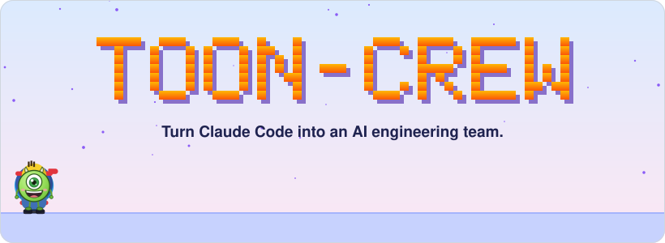

<p align="center"><picture><source media="(prefers-color-scheme: dark)" srcset="docs/images/hero-dark.svg"></picture></p>

<p align="center">
<a href="CHANGELOG.md"></a>
<a href="https://code.claude.com/docs/en/overview"></a>
<a href="docs/setup.md#requirements"></a>
</p>

<p align="center"><a href="#quick-start">Quick start</a> · <a href="#how-it-works">How it works</a> · <a href="#features">Features</a> · <a href="#the-crew">The crew</a> · <a href="#crew-room-optional">Crew Room</a> · <a href="#faq">FAQ</a> · <a href="#docs">Docs</a></p>

toon-crew is a Claude Code plugin. A manager agent plans your request and briefs 14 specialists a few at a time: backend, frontend, DevOps, security, QA, research and docs. Each does one job.

<p align="center"><b>One request in. A reviewed pull request out. Nothing merges without your yes.</b></p>

## Quick start

In Claude Code, inside any project:

```
/plugin marketplace add amanpatil808/claude-crew
/plugin install toon-crew@crew
/reload-plugins
```

Then turn the manager on for this project, one of two ways:

- Add `"agent": "toon-crew:doraemon"` to the project's `.claude/settings.json`. Edit that file yourself; the crew's guard blocks it.
- Or start a session with `claude --agent toon-crew:doraemon`.

Now ask the manager for anything. On your first request it writes `.claude/crew/project.md`; read it before you commit it.

> [!NOTE]
> The manager runs on Opus and delegates, so a crew session uses more of your plan than a plain chat. Only projects you turn it on in pay that; the board's Plan usage panel shows how much. The guard and the crew agents work in every project that has the plugin on. [Turn the manager on or off](docs/setup.md#turn-the-manager-on-or-off).

## How it works

You talk to the manager only; the diagram follows one request.

<p align="center"><picture><source media="(prefers-color-scheme: dark)" srcset="docs/images/flow-dark.svg"></picture></p>

1. **Ask.** Tell the manager what you want, in plain words.
2. **Plan and brief.** He queues the work and briefs the right specialists.
3. **Work and hand back.** Each writes a full report and a short summary.
4. **Approve and merge.** The manager opens a pull request; you say yes, DevOps merges.

## Features

<table>
<tr>
<td width="33%" valign="top">
<picture><source media="(prefers-color-scheme: dark)" srcset="docs/images/icon-crew-dark.svg"></picture><br>
<b>A crew, not one agent</b><br>
The manager plans; each specialist has one job.
</td>
<td width="33%" valign="top">
<picture><source media="(prefers-color-scheme: dark)" srcset="docs/images/icon-guard-dark.svg"></picture><br>
<b>A guard on risky steps</b><br>
Only DevOps may merge, and the guard asks you first. No auto-merge. The worst commands are refused.
</td>
<td width="33%" valign="top">
<picture><source media="(prefers-color-scheme: dark)" srcset="docs/images/icon-handback-dark.svg"></picture><br>
<b>A hand-back for every task</b><br>
A short summary and a full report on disk, so nothing is lost after <code>/clear</code>.
</td>
</tr>
<tr>
<td width="33%" valign="top">
<picture><source media="(prefers-color-scheme: dark)" srcset="docs/images/icon-worktree-dark.svg"></picture><br>
<b>Isolated builds</b><br>
Builders work in their own git worktree. Reviewers are read-only.
</td>
<td width="33%" valign="top">
<picture><source media="(prefers-color-scheme: dark)" srcset="docs/images/icon-memory-dark.svg"></picture><br>
<b>Lessons that stick</b><br>
Each agent keeps its own project memory in your repo, so lessons carry over to the next session.
</td>
<td width="33%" valign="top">
<picture><source media="(prefers-color-scheme: dark)" srcset="docs/images/icon-board-dark.svg"></picture><br>
<b>A live board, if you want it</b><br>
See desks, the queue and your plan usage as the crew works.
</td>
</tr>
</table>

## The crew

You only ever talk to the manager (Doraemon).

<details>
<summary>All 15 crew members, in nine teams</summary>

| Team | Members | What they do |
|---|---|---|
| Management | Doraemon, Miguel Rivera | Plan, brief, commit; keep lessons |
| Frontend | Nobita, Shinchan | Design direction, styles and reviews (Nobita); behaviour and logic (Shinchan) |
| Backend | Kevin, Bob | Data, logins, APIs, integrations |
| DevOps | Mike Wazowski, Sulley | CI, builds, deploys, merges |
| Security | Ninja Hattori | Attack-style reviews with proof tests |
| QA | Joe Gardner, 22 (twenty-two) | Every check, every edge case |
| Research | Dekisugi, Olaf | Cited research and fact-checks |
| Documentation | Shizuka | Docs, release notes, launch copy |
| Helpers | Stuart | Quick code lookups |

</details>

## Crew Room (optional)

The board only lets you watch. Run `/toon-crew:board`; it prints the port, usually 8811, so open `http://127.0.0.1:8811` ([guide](docs/crew-room.md)).

<p align="center"><br><sub>The Crew Room: your crew at work (demo data)</sub></p>

## Commands

| Command | What it does |
|---|---|
| `/toon-crew:board` | Starts, stops or checks the board: `start`, `stop`, `status` |
| `/toon-crew:handbacks` | Shows the hand-back folder (`dir`) or lists newest summaries (`list`) |
| `/toon-crew:project` | Turns board CI and deploy checks (`board`) or the lessons pass (`lessons`) `on` or `off`; both start off |
| `/toon-crew:compact-setup` | Adds editable "Compact instructions" to your `CLAUDE.md`, after you approve |

The crew runs the other skills; [Setup](docs/setup.md#other-skills) lists them.

## FAQ

<details>
<summary>How much of my plan does it use?</summary>

More than a plain chat: the manager runs on Opus, with 2-4 agents at once (6-8 on heavy jobs). On Pro or Max, the Plan usage panel shows your limits. [Cost in three lines](docs/how-it-works.md#5-cost-in-three-lines).

</details>

<details>
<summary>Is it safe to let it run?</summary>

The guard asks before merges and pushes to `main`, and refuses force pushes and recursive deletes. It is a seatbelt, not a sandbox: it does not check commands you type. Keep Claude Code's sandbox on. [Guards](docs/guards.md).

</details>

<details>
<summary>Do I have to use the manager everywhere?</summary>

No. The manager is opt-in per project. Turn it on with `"agent": "toon-crew:doraemon"` in that project's `.claude/settings.json`, or with `claude --agent toon-crew:doraemon`; turn it off by removing the setting. The guard keeps working either way. [Steps](docs/setup.md#turn-the-manager-on-or-off).

</details>

<details>
<summary>Does it send my code anywhere?</summary>

Not by itself. The plugin has no server; events stay on your machine with secrets redacted, and the board listens on `127.0.0.1` only. Claude Code talks to Anthropic as usual. [Privacy](docs/how-it-works.md#privacy-and-your-data).

</details>

<details>
<summary>What do I need?</summary>

Claude Code 2.1.295+, Node 24.2+ and bash. Tested on macOS; CI runs on Linux; Windows untested. [Requirements](docs/setup.md#requirements).

</details>

<details>
<summary>How do I update or uninstall?</summary>

Update with `/plugin marketplace update crew`, then `/plugin update toon-crew@crew` and `/reload-plugins`. Uninstall with `claude plugin uninstall toon-crew@crew`. [Details](docs/setup.md#update-and-uninstall).

</details>

<details>
<summary>Where do hand-backs go?</summary>

Into the plugin's data folder, one `full` and one `summaries` file per task. `/toon-crew:handbacks dir` prints the path. [Guards](docs/guards.md#hand-back-files).

</details>

## Docs

- [Setup](docs/setup.md): update, uninstall, troubleshooting
- [How it works](docs/how-it-works.md): flow, roles, privacy
- [Guards](docs/guards.md)
- [The Crew Room](docs/crew-room.md)
- [Changelog](CHANGELOG.md)

[Contributing](CONTRIBUTING.md) · [Security](SECURITY.md)

MIT licence, code only. Character names belong to their owners; toon-crew is an unofficial fan project. See [NOTICE](NOTICE) and [LICENSE](LICENSE).
