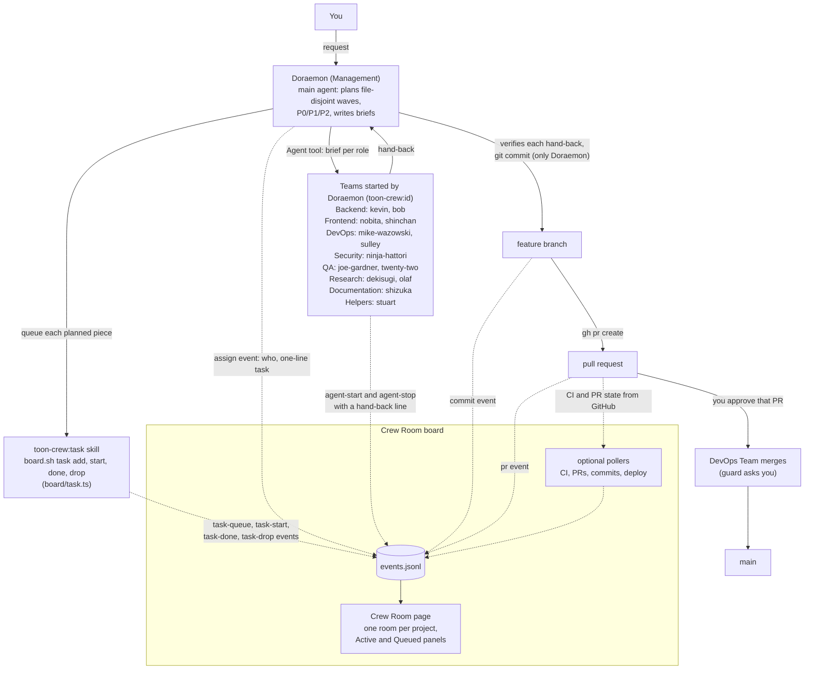
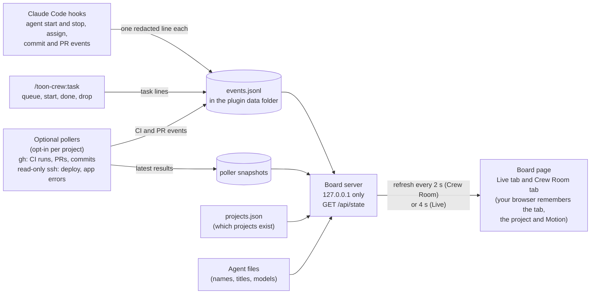
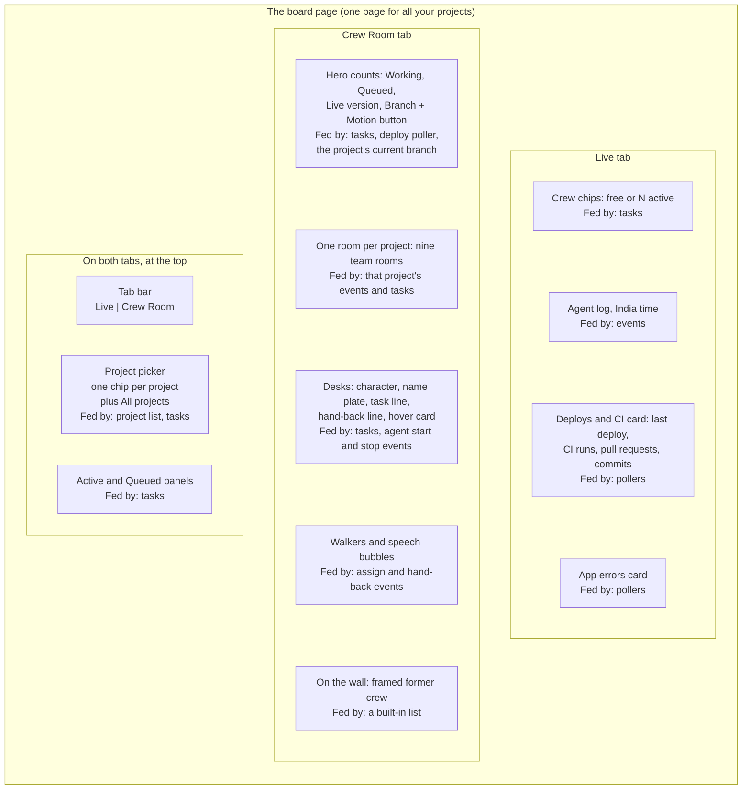

<div align="center">

# toon-crew

**A cartoon crew of 15 Claude Code agents, led by Doraemon, with safety guards and a live Crew Room board.**


[Quick start](#quick-start) · [What you get](#what-you-get) · [Commands](#slash-commands) · [The crew](#the-crew) · [Crew Room](#the-crew-room-board) · [Limits](#what-it-does-and-does-not-do) · [Guards](#guards) · [Docs](#docs-map)

</div>

```text
   .-----------------------------------------------------------.
   |  THE CREW ROOM                       (an illustration,    |
   |                                       not a screenshot)   |
   |  [Doraemon]   [Kevin]      [Mike]       [Olaf]            |
   |  managing     writing      running      checking          |
   |  3 tasks      the API      CI           a source          |
   |                                                           |
   |  WORKING 3         QUEUED  1         BRANCH  feat/cart    |
   '-----------------------------------------------------------'
```

The `toon-crew` plugin gives Claude Code a manager (Doraemon) and 14 specialists, a guard that stops risky commands, and a local status page that shows who is working on what. This is a private repo, with one plugin and one marketplace named `crew`.

## Quick start

You need git access to this private repo first (`gh auth status` is green, or an SSH key is set up). Then, in Claude Code, inside any project:

```
/plugin marketplace add amanpatil808/claude-crew
/plugin install toon-crew@crew
```

Run `/reload-plugins`, or start a new session. From a shell the same install is `claude plugin marketplace add amanpatil808/claude-crew` and then `claude plugin install toon-crew@crew`.

**What happens on first run**

1. **You talk to Doraemon.** The plugin makes him the main agent in every session (`"agent": "toon-crew:doraemon"`). If you have your own `agent` setting, yours wins.
2. **Your project is registered.** At session start the plugin records the project's path and name in its own data folder. Polling and the lessons pass are both off.
3. **He writes a project profile.** When you first ask for real work and `.claude/crew/project.md` is missing or stale, Doraemon runs the `project-profile` skill. It writes that page from what is in your repo: test and build commands, docs per role, no-go areas, deploy rules. It is checked into your project, so read it before you commit it.
4. **Nothing else starts by itself.** The board is not running yet. Open it:

```
/toon-crew:board
```

It prints `{"pid":..,"port":..}`. Open `http://127.0.0.1:<port>` in your browser. Stop it with `/toon-crew:board stop`.

## What you get

| The crew | The Crew Room | The guard | Memory |
|---|---|---|---|
| A manager and 14 specialists in nine teams. Each has one job: build, review, test, research, write, search. | A local page that shows who is working, what is queued and what was handed back, for every project you use. | A hook that checks risky tool calls before they run. It asks you or blocks. | Each agent keeps lessons for your project in your repo. |

## Slash commands

The plugin has eight skills. Each runs as `/toon-crew:<name>`.

| Command | What it does | Who runs it |
|---|---|---|
| `/toon-crew:board [start\|stop\|status]` | Starts, stops or checks the Crew Room page. `start` is the default. | You only |
| `/toon-crew:task add\|start\|done\|drop\|list` | Queues and moves Crew Room tasks, e.g. `add --role bob --priority P1 "<text>"`. | Doraemon (before each dispatch) or you |
| `/toon-crew:project [board\|lessons] [on\|off]` | Shows or flips this project's two opt-in flags: board polling and the lessons pass. Both start off. | You only |
| `/toon-crew:forget [name or path]` | Lists registered projects, or removes one from the list. It comes back at the next session in that project. | You only |
| `/toon-crew:project-profile` | Writes or refreshes `.claude/crew/project.md`. | Doraemon (first run, or when stale); you can too |
| `/toon-crew:crew-lessons` | Collects `[crew]` lessons from opted-in projects into one pull request on the crew repo. Owner-only. | The repo owner, by hand |
| `/toon-crew:security-backend` | Checklist for code that holds personal data, logins or secrets. | Kevin, Ninja Hattori and Bob load it themselves |
| `/toon-crew:integrations` | Checklist for code that calls a third-party API. | Kevin, Ninja Hattori and Bob load it themselves |

## The crew

Call a crew member as `toon-crew:<id>`, or just tell Doraemon what you need and he picks. Models, colours, retired characters and the memory-folder move are in [docs/roster.md](docs/roster.md).

| Name | Role | Team | Call it when |
|---|---|---|---|
| Doraemon (`doraemon`) | Engineering Manager | Management | Always: he is the main agent. He plans, briefs, checks every hand-back and is the only one who commits. |
| Miguel Rivera (`miguel-rivera`) | Knowledge Manager | Management | The owner runs the lessons pass. |
| Nobita (`nobita`) | UX & Design Lead | Frontend | You want a review of a real user journey, or a design direction. Reviews only. |
| Shinchan (`shinchan`) | Frontend Developer | Frontend | You have an agreed design and need the screens built. |
| Kevin (`kevin`) | Backend Lead | Backend | The work touches data, logins, secrets, APIs, integrations or background jobs. |
| Bob (`bob`) | Backend Developer | Backend | A module or route is well specified, or you need a port, lint or type fixes. |
| Mike Wazowski (`mike-wazowski`) | DevOps Engineer | DevOps | CI, builds, Docker, the local stack or setup scripts. Can merge, with your OK. |
| Sulley (`sulley`) | SRE | DevOps | Deploys, rollouts, rollbacks, backups or incidents. Can merge, with your OK. |
| Ninja Hattori (`ninja-hattori`) | Security Engineer | Security | You want an attack-style review with proof tests. Reviews only. |
| Joe Gardner (`joe-gardner`) | QA Engineer | QA | You want every check run with exact counts. Never fixes. |
| 22 (`twenty-two`) | Exploratory Tester | QA | You want odd paths and edge cases tried, with exact repro steps. Never fixes. |
| Dekisugi (`dekisugi`) | Research Lead | Research | You need cited, dated research and a ranked recommendation. |
| Olaf (`olaf`) | Research Analyst | Research | You need an evidence table or a fact-check, a link and date per row. |
| Shizuka (`shizuka`) | Technical Writer | Documentation | READMEs, guides, release notes, proofreading. Claims are checked against the code. |
| Stuart (`stuart`) | Code Search Assistant | Helpers | A quick lookup. He answers with `path:line` and never edits. |

## How it works

You talk to Doraemon only. He splits the work into waves, queues each piece on the board, starts the right specialist for each piece, reads what each one hands back, and does the checking and the commits himself. Only Doraemon commits and starts crew members (Dekisugi may hand a narrow question to Olaf or Stuart). Only the DevOps Team merges, after you approve that pull request.



The dotted lines are what the board records. A queued task sits in the Queued panel. When Doraemon assigns that role, the oldest queued task for it becomes active (an assignment with nothing queued becomes an active task itself). It is done when the agent stops, with that agent's one-line hand-back. A task nobody has touched for six hours is shown as done.

For the 16-step flow, where memory lives and how several projects share one board, read [docs/how-it-works.md](docs/how-it-works.md). It also has a diagram of how the plugin's parts fit together.

## The Crew Room board

The board is one local page for all your projects. Start it with `/toon-crew:board`. Hooks write a short, redacted line for each event to a log, and the board reads that log. Two diagrams: what feeds it, then what is on the page.

**What feeds the board**



**What is on the page, and what feeds each part**



Good to know:

- **One room per project.** Pick a project to see only its crew. **All projects** stacks the rooms, busiest first, and starts idle ones collapsed. Each room shows a project that is registered or has had an event in the last 7 days.
- **Working means an agent is running or the project has an active task for that role.** A desk with nothing going on is dimmed and asleep.
- **Hand-back lines** read "<name> handed back: <summary>", cut to 70 characters on the room and 160 in the Live tab's log.
- **Tasks are optional.** A role started with nothing queued still shows as Active.
- **Motion button.** It follows your device's reduced-motion setting until you choose. With Motion off, walks become short notes on the desks.
- **Local only.** The page listens on `127.0.0.1` (the first free port from 8811 to 8820), answers GET requests only and has no login and no buttons.
- **Times are India time (IST)** on the board. There is no time-zone setting.

Section 6 of [docs/how-it-works.md](docs/how-it-works.md) explains each part. API details are in [plugin/board/README.md](plugin/board/README.md).

## What it does and does not do

### What it does

- Gives every Claude Code session in a project a manager, **Doraemon**, who plans work in waves, gives each task a priority (P0, P1 or P2), briefs the crew, checks every hand-back and opens the pull request.
- Runs five builders (Kevin, Bob, Shinchan, Mike Wazowski, Sulley) in their **own git worktrees**, so they do not touch your working folder. Builders never commit; Doraemon reviews and commits.
- Keeps seven roles **read-only** (Nobita, Ninja Hattori, Joe Gardner, 22, Dekisugi, Olaf, Stuart). The guard enforces it.
- Checks risky Bash, file, agent and MCP calls with the **guard** before they run, and fails closed: if it cannot decide, it blocks.
- Asks you before Mike Wazowski or Sulley merges a pull request, pushes to `main`, or edits a project's `.claude/hooks`, `agents`, `skills` or `commands`.
- Shows the **Crew Room** on `127.0.0.1`: tasks, desks, hand-backs, and (if you opt in) CI runs, pull requests, commits, deploys and app errors.
- Keeps one memory folder per agent in your project (`.claude/agent-memory/toon-crew-<id>/`), checked into your repo, and one shared project page (`.claude/crew/project.md`) every agent reads first.
- Redacts secrets, one-time codes, addresses and emails from board log lines before they reach disk or the page, and blocks secrets and personal numbers from being written into memory files.
- Records which projects you use in a small list you control (`/toon-crew:forget`).

### What it does not do

**Safety**

- **The guard is not a sandbox.** It cannot see inside a script file (`bash /tmp/w.sh`), or what a tool does by itself. See [Guards](#guards).
- **Your own commands are not checked.** Commands you type with `!` and actions on GitHub's website skip the guard, so you can always merge yourself.
- **A role's tool list does not make it read-only.** Turning on memory adds Write back to a role's tools. The guard is the lock.

**Merging and deploying**

- **Nobody merges on their own.** There is no auto-merge and no admin merge, for any role. Doraemon never merges. Only Mike Wazowski and Sulley may, after you approve that pull request, and the guard asks you each time.
- **Nobody but Mike Wazowski and Sulley may push to `main`.** For them it asks you; for everyone else, Doraemon included, it is refused.
- **The plugin does not deploy anything.** A deploy happens only if your project's own rules make a merge deploy.

**The board**

- **It does not start by itself.** Run `/toon-crew:board`. It keeps running after your session ends, until you stop it.
- **No remote view, no login, no buttons.** It is localhost and read-only. It cannot assign or move tasks.
- **Polling is off until you turn it on** for a project, and a project's own files cannot turn it on. It supports GitHub (through `gh`) and one SSH deploy host only. No GitLab, no cloud provider APIs. Commits are read from local refs; it does not fetch.
- **Deploy status needs a result file in a fixed format**, and app errors come from the `docker logs` of the containers you name.
- **Done tasks are not listed on the page**, only in `/toon-crew:task list` and the board's `/api/state`.
- **The event log is not rotated.** It grows, and the board reads all of it on each refresh. How large it gets in practice has not been measured.
- **No cost or token tracking** on the board yet.
- **Times are India time only.**

**Lessons and memory**

- **Projects never share memory.** Only rules tagged `[crew]` move up, through a pull request the owner merges.
- **The lessons pass is owner-only and manual.** It opens a pull request on this repo from the owner's checkout and needs `gitleaks`. There is no schedule.

**Status and platform**

- **The evals are not run in CI.** CI runs the structure check, strict validation, the hook and board tests and a secrets scan. The eval cases are run by hand and have not been re-measured since the cast was renamed.
- **No Windows or Linux desktop setup is documented.** `board.sh` is bash. CI runs on Ubuntu; the evals ran on macOS.
- **This repo is private and unlicensed.** There is no public install and no licence to reuse the code.
- **Uninstalling removes the plugin's data folder** (event log, project list) by Claude Code's default.

## Per-project setup

Most projects need nothing. Two optional steps help.

<details>
<summary>Recommended: make builders start from your branch</summary>

Plugin settings can only set `agent` and `subagentStatusLine`; Claude Code drops every other key. So anything else goes in each project's own `.claude/settings.json`:

```json
{
  "worktree": { "baseRef": "head" },
  "env": { "CLAUDE_CODE_SUBAGENT_MODEL": "sonnet" }
}
```

- `worktree.baseRef: head` (recommended): builders that work in their own worktree (kevin, bob, shinchan, mike-wazowski, sulley) start from your working branch, not the default branch.
- `CLAUDE_CODE_SUBAGENT_MODEL` (optional): this does **not** make the crew cheaper. Claude Code picks a subagent's model in this order: the `model` passed on the call, then the agent file's `model`, then this variable, then the main session's model. Every crew agent sets its own `model`, so the variable only reaches agents without one, such as the built-in general-purpose agent.
- Do not set `CLAUDE_CODE_SUBAGENT_MODEL_FORCE`. It makes Claude Code ignore every agent file's `model` and every per-call model, so it would quietly move every crew role onto one model.
- Optional, your choice: `/model opusplan` runs the main session on Opus in plan mode and on Sonnet the rest of the time.

> [!NOTE]
> The guard blocks Claude from editing `.claude/settings*.json`, so make these edits yourself.

</details>

<details>
<summary>Optional: show CI, pull requests, commits and deploys on the board</summary>

Two things are needed, and both are yours to decide. Run this in the project:

```
/toon-crew:project board on
```

Then add a `## Board` section to the project's `.claude/crew/project.md` (the `project-profile` skill can write one):

```markdown
## Board
- github: owner/repo
- branches: main, feat/x
```

`github` turns on CI, pull request and commit polling through `gh`. The `deploy-ssh`, `deploy-result`, `deploy-log` and `deploy-containers` keys turn on a read-only deploy check over ssh. All keys and their formats are in [plugin/board/README.md](plugin/board/README.md). With no section, or with the flag off, nothing is polled.

</details>

## Guards

The guard is a hook that reads each risky tool call before it runs and answers allow, ask or block. It covers Bash, Monitor, Edit, Write, MultiEdit, NotebookEdit, Agent, SendMessage, CronCreate, Workflow, RemoteTrigger, Read, Grep and `mcp__*` tools.

> [!WARNING]
> The guard is a seatbelt, not a sandbox. It catches mistakes and lazy bypasses, but a determined agent with a shell can get around a text check, for example with a script file. Keep Claude Code's sandbox on for roles that have Bash.

| What | What happens |
|---|---|
| Push to `main` or `master` | Mike Wazowski and Sulley: asks you. Everyone else, Doraemon included: refused. |
| Merge or approve a pull request | Mike Wazowski and Sulley: asks you. Everyone else: refused. `--admin` and `--auto` merges: refused for all. |
| Force push, deleting a repo, changing branch protection | Refused for everyone. |
| Recursive delete | Refused, except inside temp and scratch folders. |
| `docker ... down -v`, volume removal and prune | Refused for everyone. |
| `.claude/settings*.json`, `.git/config`, `.git/hooks`, `.mcp.json`, the installed plugin | Writes refused. |
| A project's `.claude/hooks`, `agents`, `skills`, `commands` | Writes ask you. |
| `~/.config/gh` and `~/.git-credentials` | Reads refused for every role. |
| Memory files | Secrets, emails, card and phone numbers refused. |
| Read-only roles | Cannot edit your code or change the git tree. |
| Starting crew agents | Only Doraemon. Dekisugi may start Olaf or Stuart. |

If the guard cannot read its input, crashes or times out, the call is blocked. Every rule, who it applies to and what the guard cannot see is in [docs/guards.md](docs/guards.md).

## Privacy and your data

- **The plugin has no server and sends nothing by itself.** Claude Code talks to Anthropic as it always does. The board runs on your machine.
- **The event log and project list** live in the plugin's data folder (`$CLAUDE_PLUGIN_DATA`, or `~/.toon-crew` when you start the board by hand). Files are mode 0600 and folders 0700. Log lines are short and redacted: an assignment keeps only the task's short description, never the full prompt, and a hand-back is cut to 160 characters.
- **The project list** holds each project's path, name, first and last seen, and two opt-in flags. It never holds secrets. `/toon-crew:forget` removes a project.
- **Memory and `project.md` live in your project** and are meant to be checked in. Keep secrets out; the guard blocks the obvious ones.
- **Polling talks to GitHub and your deploy host only if you opt a project in.** It runs `gh` and a read-only `ssh` on your machine.
- **Lessons leave a project only through a pull request** that the owner of this repo reviews and merges. Only `[crew]` rules move; `[project]` facts stay.

## Requirements

- **Claude Code 2.1.295 or later.** The guard hook uses `"onFailure": "block"`, which older versions do not support.
- **Node 24.2 or later.** The board scripts are TypeScript run directly by Node, and the board's hook uses `import.meta.main`, which Node added in 24.2.
- **git access to this private repo**, to install.
- **`gh`**, only if you turn on CI and pull request polling.
- **`gitleaks`**, only for the owner's lessons pass.
- There is nothing to `npm install`: the plugin has no dependencies.

## Update and uninstall

`version` in `plugin/.claude-plugin/plugin.json` pins each project to a release, so nothing changes until you ask:

```
/plugin marketplace update crew
/plugin update toon-crew@crew
```

Then `/reload-plugins`. Read [CHANGELOG.md](CHANGELOG.md) first. To remove the plugin, use `/plugin` and uninstall `toon-crew`; Claude Code's default also deletes the plugin's data folder.

<details>
<summary>Troubleshooting</summary>

- **The board is empty.** The hooks and the board must use the same data folder. Start the board with `/toon-crew:board`, not by hand.
- **The board shows a project but no CI or deploys.** Polling is off until you run `/toon-crew:project board on` and the project's `project.md` has a `## Board` section.
- **Nothing is logged at all.** Check your Node version with `node --version`. The board's hook needs 24.2 or later. (On older Node it likely loads but writes no events; that has not been tested.)
- **A builder's worktree started from the wrong branch.** Set `"worktree": { "baseRef": "head" }` in the project's `.claude/settings.json` (see [Per-project setup](#per-project-setup)).
- **A read-only agent wrote a file.** It can write only its own memory file, temp folders and its docs folder. See [docs/guards.md](docs/guards.md).
- **The guard blocked something you want.** Run that command yourself with `!`, or on GitHub's website. The guard does not check your own commands.

</details>

## Docs map

| You want | Read |
|---|---|
| The 16-step flow, where memory lives, several projects, the board in full | [docs/how-it-works.md](docs/how-it-works.md) |
| Every crew member: model, effort, colour, retired characters, memory-folder move | [docs/roster.md](docs/roster.md) |
| Every guard rule and what it cannot see | [docs/guards.md](docs/guards.md) |
| Board API, data folders, task commands, `## Board` keys | [plugin/board/README.md](plugin/board/README.md) |
| What changed in each version | [CHANGELOG.md](CHANGELOG.md) |
| What it costs to run the crew | [docs/cost-baseline.md](docs/cost-baseline.md) |
| The eval cases | [plugin/evals/README.md](plugin/evals/README.md) |
| Why it was built this way | [docs/planning/toon-crew-plan.md](docs/planning/toon-crew-plan.md) |

## Develop

The installable plugin lives in `plugin/` (agents, skills, hooks, board, evals, settings). The marketplace entry points at `./plugin`, so `docs/`, CI files and planning notes are not copied into installs. The repo root holds the marketplace file, docs, scripts and CI.

<details>
<summary>Commands</summary>

```
node --test plugin/hooks/test/*.test.mjs                 # guard, review proofs and registry tests
node --no-warnings --test plugin/board/test/*.test.ts    # board tests
node scripts/check-structure.mjs                         # manifest, marketplace, hooks checks
claude plugin validate . --strict                        # marketplace
claude plugin validate ./plugin --strict                 # plugin
claude --plugin-dir ./plugin                             # try the plugin in a session
```

</details>
