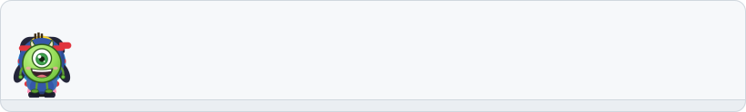
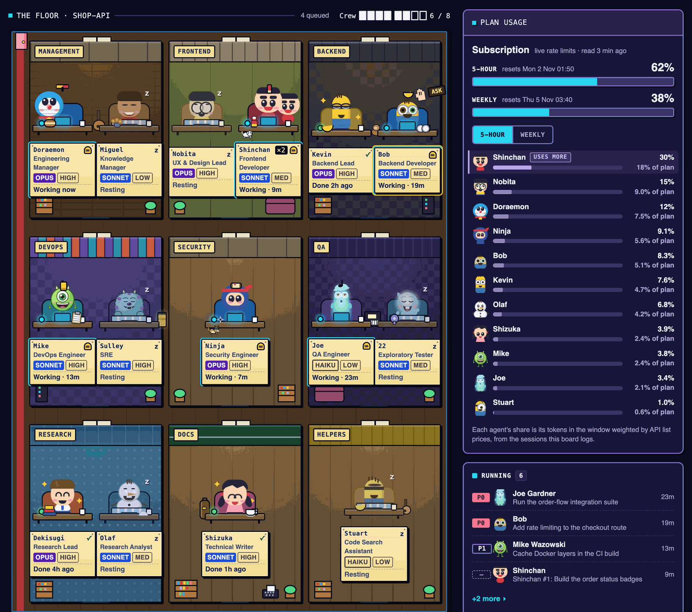

<p align="center"><picture><source media="(prefers-color-scheme: dark)" srcset="docs/images/crew-banner-dark.svg"></picture></p>

# toon-crew

**Turn Claude Code into an AI engineering team.**

[](CHANGELOG.md) [](https://code.claude.com/docs/en/overview) [](docs/setup.md#requirements)

toon-crew is a Claude Code plugin. A manager agent, Doraemon, plans your request and briefs 14 specialists, a few at a time: backend, frontend, DevOps, security, QA, research and docs. Each does one job.

## Quick start

In Claude Code, inside any project:

```
/plugin marketplace add amanpatil808/claude-crew
/plugin install toon-crew@crew
/reload-plugins
```

Then ask Doraemon for anything. On your first request he writes `.claude/crew/project.md`; read it before you commit it.

> [!NOTE]
> Doraemon becomes your main agent. He runs on Opus and delegates, so a crew uses more of your plan than a plain chat; the board's Plan usage panel shows how much. [How to turn him off](docs/setup.md#turn-doraemon-off).

## How it works

You talk to Doraemon only; the diagram follows one request.

<p align="center"><picture><source media="(prefers-color-scheme: dark)" srcset="docs/images/architecture-dark.svg"></picture></p>

1. **Ask.** Tell Doraemon what you want, in plain words.
2. **Plan and brief.** He queues the work and briefs the right specialists.
3. **Work and hand back.** Each writes a full report and a short summary.
4. **Approve and merge.** Doraemon opens a pull request; you say yes, DevOps merges.

## What you get

- **A crew, not one agent.** Each specialist has one job and its own project memory.
- **A guard on risky steps.** Only DevOps may merge or push to `main`, and only after you say yes; the worst commands are refused.
- **A hand-back for every task.** A short summary and a full report, so nothing is lost after `/clear`.
- **A live board, if you want it.** Desks, the queue and, on Pro or Max, plan usage.
- **You approve every merge.** No auto-merge, for any role.

<details>
<summary>All 15 crew members, in nine teams</summary>

| Team | Members | What they do |
|---|---|---|
| Management | Doraemon, Miguel Rivera | Plan, brief, commit; keep lessons |
| Frontend | Nobita, Shinchan | Design direction, styles and reviews (Nobita); behaviour and logic (Shinchan) |
| Backend | Kevin, Bob | Data, logins, APIs, integrations |
| DevOps | Mike Wazowski, Sulley | CI, builds, deploys, merges |
| Security | Ninja Hattori | Attack-style reviews with proof tests |
| QA | Joe Gardner, 22 (twenty-two) | Every check, every edge case |
| Research | Dekisugi, Olaf | Cited research and fact-checks |
| Documentation | Shizuka | Docs, release notes, launch copy |
| Helpers | Stuart | Quick code lookups |

</details>

## Live board (optional)

The crew works fine without it; the board only lets you watch. Run `/toon-crew:board`; it prints the port, usually 8811, so open `http://127.0.0.1:8811` ([guide](docs/crew-room.md)).

<p align="center"><br><sub>The Crew Room: your crew at work (demo data)</sub></p>

## Commands

| Command | What it does |
|---|---|
| `/toon-crew:board` | Starts, stops or checks the board: `start`, `stop`, `status` |
| `/toon-crew:handbacks` | Shows the hand-back folder (`dir`) or lists newest summaries (`list`) |
| `/toon-crew:project` | Turns board CI and deploy checks (`board`) or the lessons pass (`lessons`) `on` or `off`; both start off |
| `/toon-crew:compact-setup` | Adds editable "Compact instructions" to your `CLAUDE.md`, after you approve |

Doraemon and the crew run most other skills; [Setup](docs/setup.md#other-skills) lists them all.

## Good to know

- **A seatbelt, not a sandbox.** An agent with a shell can get around the guard, and it does not check commands you type. Keep Claude Code's sandbox on. [Guards](docs/guards.md).
- **The board is local.** It listens on `127.0.0.1`, has no login and answers read requests only.
- **Requirements.** Claude Code 2.1.295+, Node 24.2+, bash. Tested on macOS, CI on Linux, Windows untested.
- **Privacy.** No server; the plugin sends nothing by itself. Events stay on your machine, secrets redacted. [Details](docs/how-it-works.md#privacy-and-your-data).
- **More.** [Setup](docs/setup.md) covers turning Doraemon off, update, uninstall and troubleshooting.

MIT licence, code only. Character names belong to their owners; toon-crew is an unofficial fan project. See [NOTICE](NOTICE) and [LICENSE](LICENSE).

[Setup](docs/setup.md) · [How it works](docs/how-it-works.md) · [Guards](docs/guards.md) · [The Crew Room](docs/crew-room.md) · [Changelog](CHANGELOG.md) · [Contributing](CONTRIBUTING.md) · [Security](SECURITY.md)
