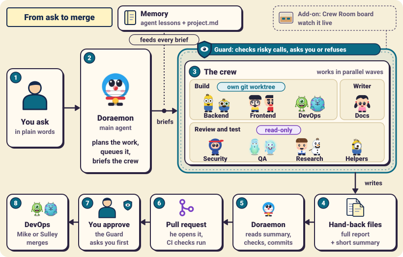
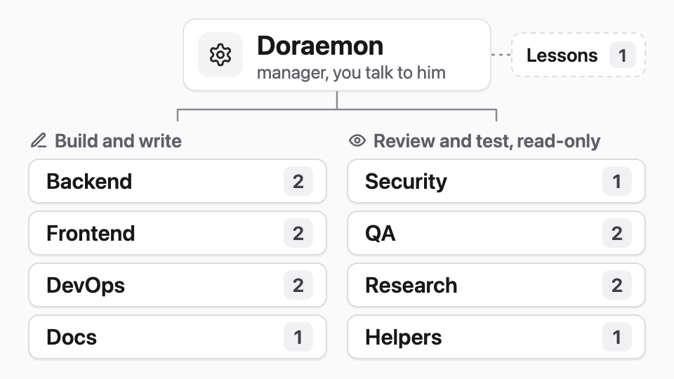
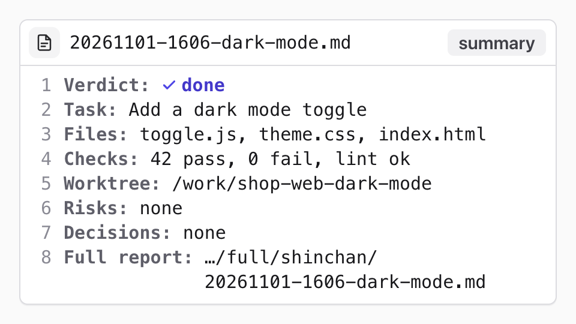
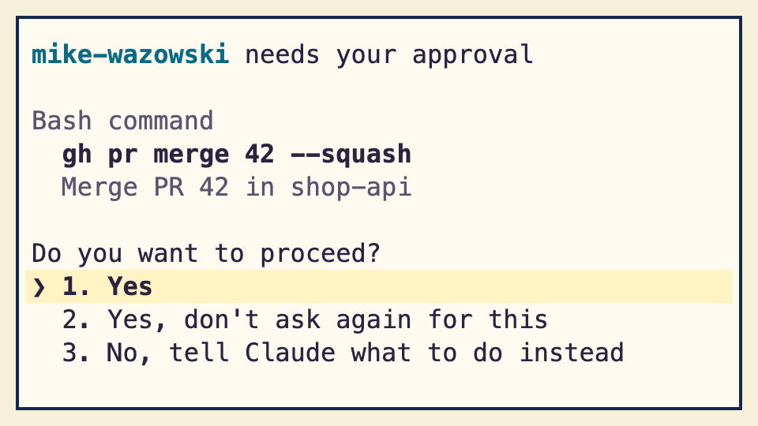
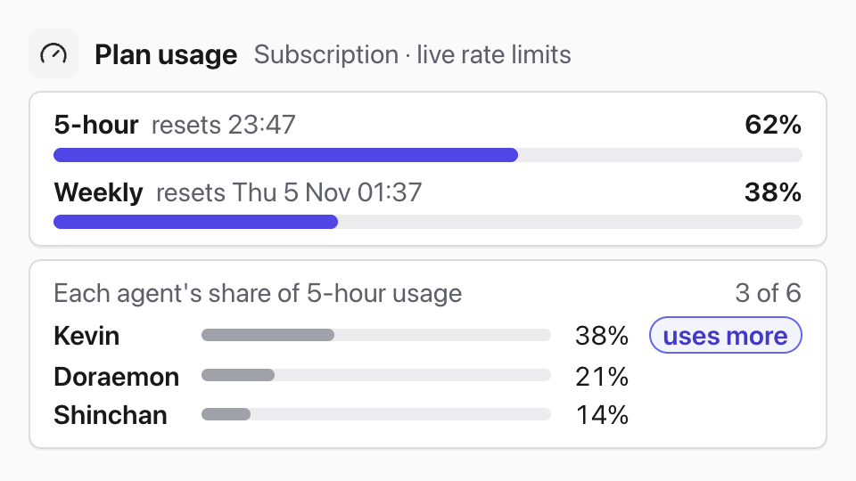
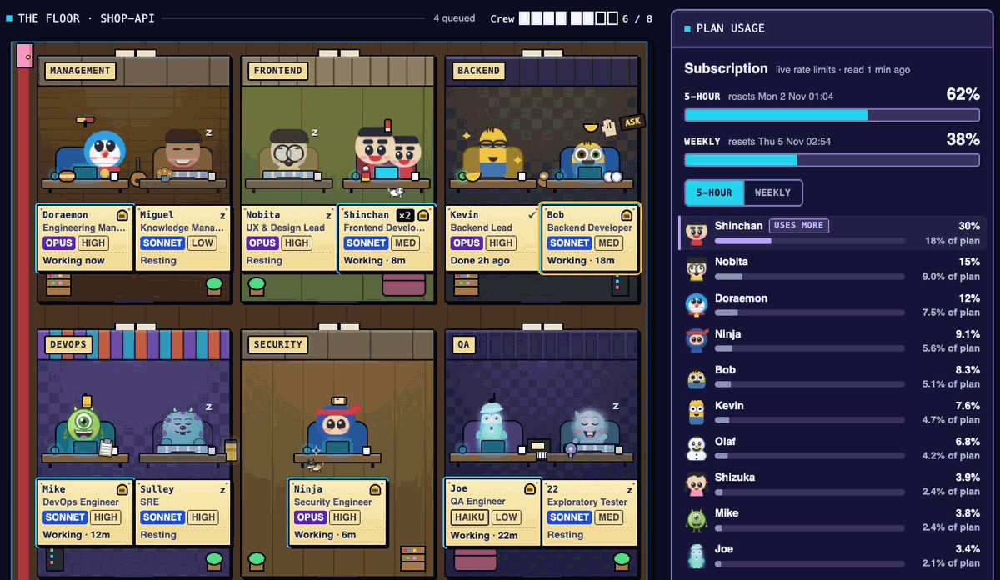

<div align="center">
<h1>toon-crew</h1>
<p>   </p>
</div>

**toon-crew turns Claude Code into an AI engineering team.** Instead of one agent doing everything in one long chat, a manager agent, Doraemon, plans the work and runs 14 specialists in parallel, each with one job: backend, frontend, DevOps, security, QA, research or docs. A guard asks you before risky commands and refuses the worst. Every task ends with a written hand-back, and the crew merges no pull request without your yes.

The crew are cartoon characters used as memorable role names. toon-crew is an unofficial fan project; see [Characters and licence](#characters-and-licence).

## Quick start
In Claude Code, inside any project:

```
/plugin marketplace add amanpatil808/claude-crew
/plugin install toon-crew@crew
/reload-plugins
```

Then ask Doraemon for anything. On your first request he writes `.claude/crew/project.md`. Read it before you commit it.

Doraemon becomes your main agent in every project where the plugin is on. He runs on Opus and delegates a lot, so a crew uses more of your plan than a plain chat. To switch him off, see [Turn Doraemon off](#turn-doraemon-off).

## How it works
<p align="center"><picture><source media="(prefers-color-scheme: dark)" srcset="docs/images/architecture-dark.svg"></picture></p>

1. **You ask in plain words.** You talk to Doraemon only.
2. **Doraemon plans and briefs.** He queues the work and briefs the right specialist; agent memory and `project.md` feed every brief.
3. **The crew works in parallel.** Each member leaves a full report and a short summary; the guard asks you before risky steps and refuses the worst.
4. **You approve, DevOps merges.** Doraemon reads the summaries, checks the work, commits and opens a draft pull request; CI runs; Mike or Sulley merges after you say yes.

## What you get
<table>
<tr>
<td width="50%" valign="top">
<p><b>A crew, not one agent</b><br>
Doraemon plans; 14 specialists each do one job.<br>
<picture><source media="(prefers-color-scheme: dark)" srcset="docs/images/card-crew-dark.png"></picture></p>
<p><b>A written hand-back for every task</b><br>
A short summary and a full report you can reread.<br>
<picture><source media="(prefers-color-scheme: dark)" srcset="docs/images/card-handback-dark.png"></picture></p>
</td>
<td width="50%" valign="top">
<p><b>A guard on risky steps</b><br>
It asks before risky commands; the worst are refused.<br>
<picture><source media="(prefers-color-scheme: dark)" srcset="docs/images/card-guard-dark.png"></picture></p>
<p><b>A live board, if you want one</b><br>
Who is working, what is queued, how much plan is left.<br>
<picture><source media="(prefers-color-scheme: dark)" srcset="docs/images/card-plan-dark.png"></picture></p>
</td>
</tr>
</table>

<details>
<summary>All 15 crew members, in nine teams</summary>

| Team | Members | What they do |
|---|---|---|
| Management | Doraemon, Miguel Rivera | Plan, brief, commit; keep lessons |
| Frontend | Nobita, Shinchan | Design direction, styles and reviews (Nobita); behaviour and logic (Shinchan) |
| Backend | Kevin, Bob | Data, logins, APIs, integrations |
| DevOps | Mike Wazowski, Sulley | CI, builds, deploys, merges |
| Security | Ninja Hattori | Attack-style reviews with proof tests |
| QA | Joe Gardner, 22 (twenty-two) | Every check, every edge case |
| Research | Dekisugi, Olaf | Cited research and fact-checks |
| Documentation | Shizuka | Docs, release notes, launch copy |
| Helpers | Stuart | Quick code lookups |

</details>

## Live board (optional)
The crew works fine without it; the board only lets you watch. Run `/toon-crew:board`. It prints the port, usually `8811`, so open `http://127.0.0.1:8811` (or your port) in your browser. When the crew needs you (a permission ask, a reply, a pull request to review), a "Needs you" list says so. More in [The Crew Room](docs/crew-room.md).

<p align="center"><picture><source media="(prefers-color-scheme: dark)" srcset="docs/images/hero-dark.gif"></picture><br><sub>The Crew Room: your crew at work, live (demo data)</sub></p>

## Commands
| Command | What it does |
|---|---|
| `/toon-crew:board [start\|stop\|status]` | Starts, stops or checks the board |
| `/toon-crew:project [board\|lessons] [on\|off]` | Turns CI and deploy checks, or the shared-lessons pass, on or off (both start off) |
| `/toon-crew:handbacks [dir\|list]` | Shows the hand-back folder, or lists the newest summaries |
| `/toon-crew:compact-setup` | Adds editable "Compact instructions" to your CLAUDE.md, after you approve the text |
| `/toon-crew:forget [name or path]` | Removes a project from the board's list |
| `/toon-crew:task` | Queues and moves board tasks (`add`, `start`, `done`, `drop`, `list`); Doraemon runs it for you |

Crew members use the other skills automatically; `/toon-crew:crew-lessons` is for the repo owner only.

## Good to know
- **The guard is a seatbelt, not a sandbox.** An agent with a shell can get around it, and it does not check commands you type yourself. Keep Claude Code's sandbox on. [Guards](docs/guards.md) has the rules and limits.
- **The board is local only.** It listens on `127.0.0.1`, has no login, answers read requests only and shows India time (IST).
- **Requirements:** Claude Code 2.1.295+, Node 24.2+ and bash (the board script is bash). Tested on macOS. CI runs the tests on Linux (Ubuntu). Windows is untested.
- **Privacy:** the plugin has no server and sends nothing by itself. Claude Code talks to Anthropic as it always does, and `gh` or `ssh` run on your machine only if you turn on board polling. Crew events and the project list stay in the plugin's data folder, with secrets redacted first. [Details](docs/how-it-works.md#privacy-and-your-data).

### Turn Doraemon off
The plugin sets `"agent": "toon-crew:doraemon"`. If you set your own `agent` in Claude Code settings, yours wins; for one project, put it in that project's `.claude/settings.json` (edit it yourself, the guard blocks the crew from it). Or turn the plugin off for one project with `claude plugin disable toon-crew@crew --scope project`.

### Update and uninstall
```
/plugin marketplace update crew
/plugin update toon-crew@crew
/reload-plugins
```
Read the [changelog](CHANGELOG.md) first. To remove it, use `/plugin` and uninstall `toon-crew`, or run `claude plugin uninstall toon-crew@crew`; Claude Code also deletes the plugin's data folder unless you pass `--keep-data`. Your project's `.claude/crew/` and agent memory stay.

### Troubleshooting
- **`/toon-crew:...` commands are missing.** Run `/reload-plugins`, then `/plugin` to check that `toon-crew` is enabled.
- **Doraemon is not answering.** Check for your own `agent` setting, which wins over the plugin's, and for the plugin being disabled in this project.
- **Install or update fails.** Run `claude --version` (2.1.295+) and `git --version`, and check your network: Claude Code clones the marketplace from GitHub.
- **The board is empty or nothing is logged.** Run `node --version` (24.2+), then start the board with `/toon-crew:board`.

More in [Setup](docs/setup.md#troubleshooting).

## Characters and licence
The character names and likenesses belong to their owners, and toon-crew is not affiliated with or endorsed by them; see [NOTICE](NOTICE). The code is MIT, see [LICENSE](LICENSE). The MIT licence covers the code only, not character names or the pictures of them.

## Contributing and security
Found a bug or have an idea? [Open an issue](https://github.com/amanpatil808/claude-crew/issues). To work on the plugin, read [CONTRIBUTING.md](CONTRIBUTING.md). For a security problem in the guard, hooks or board, follow [SECURITY.md](SECURITY.md) and do not open a public issue.

[Setup](docs/setup.md) · [How it works](docs/how-it-works.md) · [Guards](docs/guards.md) · [The Crew Room](docs/crew-room.md) · [Changelog](CHANGELOG.md)
