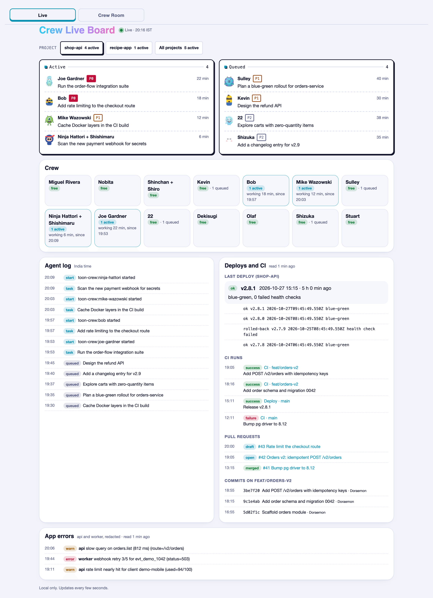
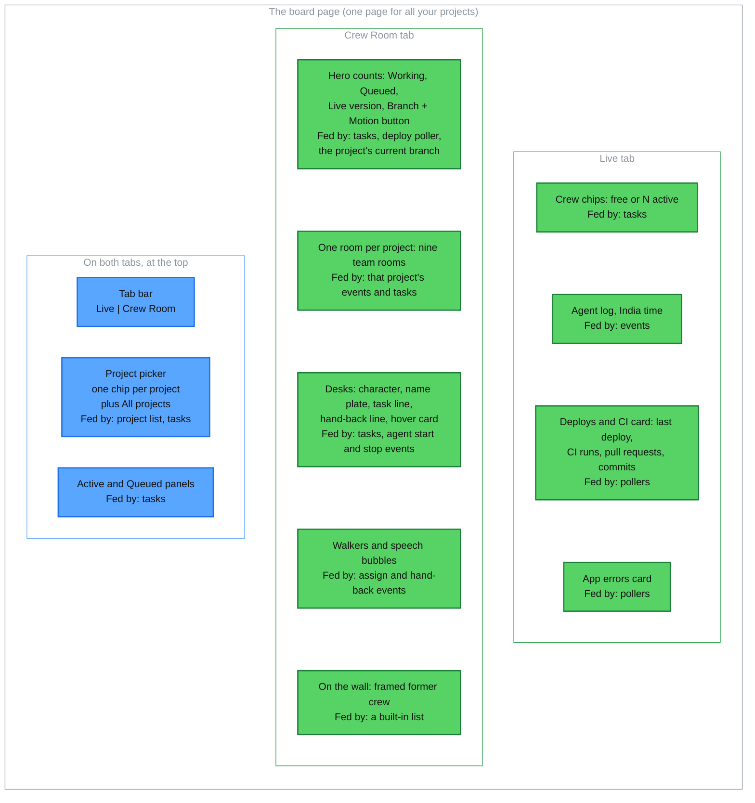
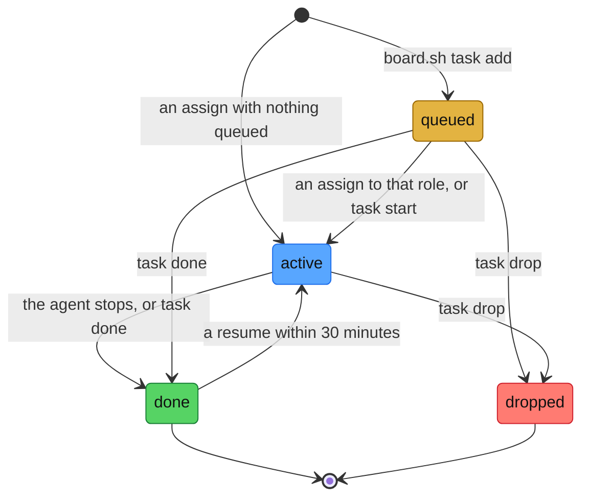
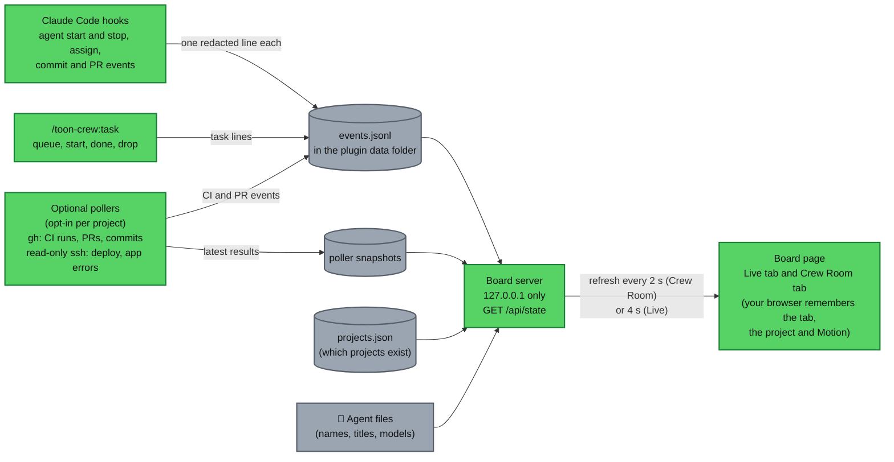

# The Crew Room board

For anyone who has installed `toon-crew`. After reading this you can start the board, read each part of the page, queue a task and look up a retired character. The short version is in the [README](../README.md).

The board is one local page for all your projects. Hooks write a short, redacted line for each event to a log, and the board reads that log. It is optional: the hooks write the log whether or not the board is running.

<p align="center">
  <picture>
    <source media="(prefers-color-scheme: dark)" srcset="images/live-dark.png">
    
  </picture>
  <br>
  <sub>Live tab with demo data</sub>
</p>

Both board screenshots (this one and the Crew Room one in the README) show demo data. To see it yourself, from a clone of this repo (the installed plugin has no `scripts/` folder), run `node scripts/board-demo.mjs /tmp/crew-demo`. It seeds a new empty folder and prints the exact `board.sh start` and `stop` commands. Running it again on the same folder re-seeds it. It refuses a non-empty folder it did not create, `~/.toon-crew`, anything under `~/.claude`, your home folder, and any folder whose board is still running.

## Start it

- Type `/toon-crew:board` (it takes `start`, `stop` or `status`; the default is `start`). It prints `{"pid":..,"port":..}`. Open `http://127.0.0.1:<port>`. Only you can run this skill (`disable-model-invocation: true`).
- Without the skill, run the command it runs: `CLAUDE_PLUGIN_DATA="${CLAUDE_PLUGIN_DATA}" bash "${CLAUDE_PLUGIN_ROOT}/board/board.sh" start`. Use the same data folder as the hooks, or the board shows nothing.
- It does not start by itself, and it keeps running after your session ends until you stop it.

## Good to know

- **Local only.** The page listens on `127.0.0.1` (the first free port from 8811 to 8820), answers GET requests only and has no login and no buttons. It cannot assign or move tasks.
- **Times are India time (IST).** There is no time-zone setting.
- **Working** means an agent is running or the project has an active task for that role. A desk with nothing going on is dimmed and asleep.
- **Hand-back lines** read "<name> handed back: <summary>", cut to 70 characters on the room and 160 in the Live tab's log.
- **Tasks are optional.** A role started with nothing queued still shows as Active.

API details are in [plugin/board/README.md](../plugin/board/README.md).

## What is on the page

The page has two tabs, **Live** and **Crew Room**. It remembers the tab you used last (`#room` in the address opens the Crew Room). Both tabs share the project picker and the **Active** and **Queued** panels, so they always show the same tasks. The diagram shows each part and what feeds it.



### The project picker

- **What it is.** Under the tab bar, a row of chips labelled PROJECT: one per project, then **All projects**. The picked chip is bold, with a darker border and a shadow. Each chip shows how many tasks are active in that project ("2 active"). One click switches, and the page address gets `?project=<name>`. The pick applies to both tabs. With **All projects**, each task row also names its project, and the Crew Room stacks the rooms, busiest first, with idle ones collapsed.
- **What is listed.** A project that is registered or has had an event in the last 7 days.
- **Which is picked first.** In this order: the `?project=` value in the address, the project you picked last time (the page keeps it in your browser), the project with the newest event, then **All projects**. While the page stays open it keeps your pick.

### The Crew Room tab

A pixel-art office with one room per project, a room per team and a desk for each crew member. It is the quick, friendly view: who is at work, who is free, what just happened. It refreshes every 2 seconds.

- **Header.** Counts for the picked project: Working and Queued (the same numbers as the panels), the live version and the branch. The **Motion** button (MOTION ON or MOTION OFF) turns the animation on or off. Until you choose, it follows your device's reduced-motion setting; the page remembers your choice.
- **Desks.** A character at a desk shows who is working, idle or done, in that role's colour. No crew member is green: green means "ok" on the board (the Live status dot, a deploy that worked, a live version).
- **Walkers and bubbles.** When Doraemon starts a role on a task, he walks the corridor to that desk with the task on a piece of paper and says its text in a speech bubble. When a role hands back, it walks to Doraemon's desk with the result. Doraemon also looks in on someone who has worked a while without contact. At most two characters walk at once (three when several project rooms are open). With Motion off, the same events show as short notes on the desks.
- **Hover cards.** Hover a desk (or focus it with the keyboard, or tap it) for a card: role and team, how long it has been working or since it finished, its task, its model and its last hand-back. Esc or a click elsewhere closes it.
- **The wall.** Framed pictures of the characters who left the crew (see [The wall](#the-wall-retired-characters)).

### The Live tab

The plain, text view. It refreshes every 4 seconds. The header says "Live" with the time, or "Server not answering; retrying…" if the board has stopped; the last data stays on screen. The Agent log says nothing is logged yet when the log is empty.

Deploys and CI, and App errors, need polling, which you turn on per project ([setup](setup.md#optional-show-ci-pull-requests-commits-and-deploys-on-the-board)). Without it those cards say nothing has been read yet. App errors come from the containers named in the project's `deploy-containers` setting, redacted. A pull request opened, merged, closed or reopened with `gh pr` in a session is logged by the hooks without polling.

## Tasks

A task is one piece of work for one role in one project. The board works it out from the event log; nothing else is stored. Doraemon queues each planned piece with the `toon-crew:task` skill, which runs the `board.sh task` commands below. You can run them too.



Here `board.sh` stands for `bash "${CLAUDE_PLUGIN_ROOT}/board/board.sh"`, run with `CLAUDE_PLUGIN_DATA` set to the hooks' data folder (with another folder the task goes into a different log and the board never sees it). Run it from the project the task is for: the project is the registered name of `CLAUDE_PROJECT_DIR`, else the current folder's name.

```bash
board.sh task add --role <id> [--priority P0|P1|P2] [--ref <branch|PR>] "<text>"
board.sh task start <id>
board.sh task done <id> [--ref <branch|PR>]
board.sh task drop <id>
board.sh task list [--all] [--json]
```

- **Queued.** `add` prints `queued t-<number>-<hex>`; that is the task id. The role must be one of the 15 crew ids, or `add` refuses and lists them. `--priority` is optional; any other value is refused. The text is one line: extra spaces are folded, secrets are redacted, then it is cut to 120 characters (cut, not refused). `--ref` is cut to 80.
- **Active.** An assign (Doraemon starting that role in that project) takes the **oldest** queued task for that role and project, whatever its priority. With nothing queued, the assign itself becomes an active task, with its short description as the text and no priority. `task start <id>` does the same for one queued task by hand.
- **Done.** The role's stop event finishes the oldest active task for that role in that project, with that agent's one-line hand-back. `task done <id>` does it by hand, for a queued or an active task. A task nobody has touched for six hours is shown as done.
- **Dropped.** `task drop <id>` works on a queued or an active task and hides it. `task start` works only on a queued task. A task already done or dropped is refused with "is already done" (or "dropped"), and an unknown id with "no task".
- **Resume.** A message to an existing agent (SendMessage) does not make a new task. If that role finished a task in the same project within the last 30 minutes, the latest one goes back to active. Otherwise nothing changes.
- **Late assign.** An assign that arrives within 5 seconds after the same role stopped in the same project is ignored, unless that role started again in between. (A foreground agent call reports its assign just after the agent has stopped; without this rule it would show as a second task.)
- **Order.** Active tasks are oldest first. Queued tasks go by priority (P0, P1, P2, then none), then oldest first. The board keeps the last 10 done tasks, newest first.
- **Where you see them.** Both tabs show the Active and Queued panels. Done tasks are in `board.sh task list` and in `/api/state`; the page lists none. The Live tab's Agent log shows the finish as a "done" line.
- **Model override.** An active task shows `model override: <name>` when the call asked for a model that differs from the agent file's.

Sources: `plugin/board/task.ts` (commands, refusals) and `plugin/board/lib/tasks.ts` (priorities, 120 characters, 10 done, 30 minutes, 5 seconds, states, order). Checked by running `board.sh task add|list|start|done|drop` against a throwaway data folder: a 150-character text came back as 120, `P9` and an unknown role were refused, and a second `start` or `done` said "already".

## What feeds the board



How the hooks, the log and the data folder fit together is in [how it works](how-it-works.md#3-where-things-live).

## The wall: retired characters

These characters left the active crew. The Crew Room's wall shows them as framed pictures, each with a plate saying who took over. Old references to them (memory folders, old board events) map to the role that took over. The built-in list is in `plugin/board/lib/roster.ts`; moving old memory folders is in [Upgrading from 0.x](setup.md#upgrading-from-0x).

| Retired | Was | Now with | What moved |
|---|---|---|---|
| Dorami | Crew keeper | miguel-rivera | Lessons pass, confirmed crew records, the only crew-repo push (lessons PRs) |
| Scrooge McDuck (and Shaktimaan) | Expert backend; guardrails, connectors, worker | kevin | Tests per security rule, the `security-backend` and `integrations` checklists |
| Bob the Builder (and Ninja Hattori's old routes role) | Builder; API routes | bob | Parity tests, spec gaps, user-isolation tests |
| Chhota Bheem (and Dekisugi's old SRE role) | DevOps and SRE | mike-wazowski, sulley | CI, builds and local stack to Mike; deploys, rollbacks, backups and incidents to Sulley; never `down -v` for both |
| Scooby-Doo | Security reviewer | ninja-hattori | Proof tests that fail before the fix, the race checklist |
| Tom | Tester | joe-gardner | Exact counts, three runs, "not run" is never "passed" |
| Dexter | Research lead | dekisugi | Cite and date every claim, the fact x places table |
| Velma | Analyst | olaf | A link and date per row, "unverified" marks |
| Chip 'n Dale | Quick lookups | stuart | Read-only, path:line answers, the default for lookups |
| Suneo | Junior writer | shizuka | Drafts, glossaries, proofreading, `TODO(verify)` |

Dekisugi and Ninja Hattori are active again in new jobs. Board events typed with their names from before 23 Oct belong to their old jobs and may show under the new owners.
