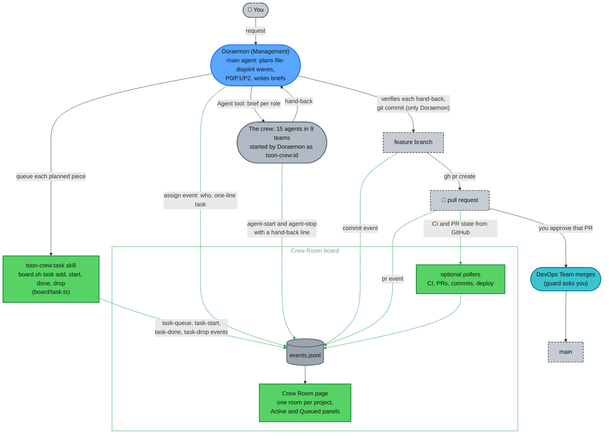
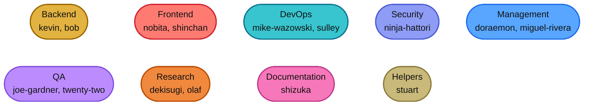
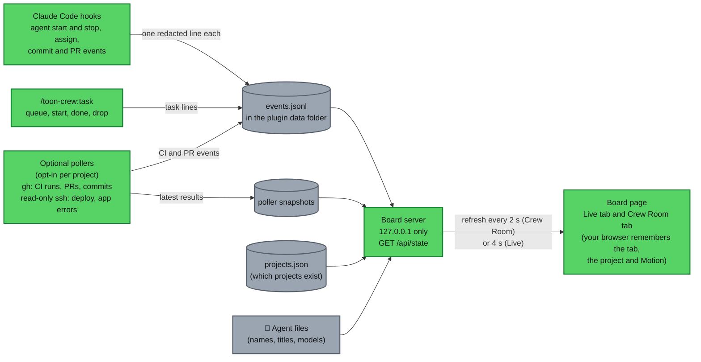
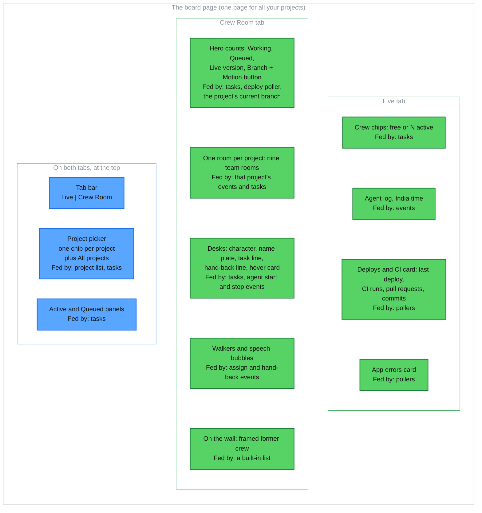

# The Crew Room board

For anyone who has installed the `toon-crew` plugin and wants to know what the board shows, what feeds it and what to do when it looks wrong. The short version is in the [README](../README.md). The step-by-step walk-through is in [section 6 of how-it-works.md](how-it-works.md#6-using-the-board).

The board is one local page for all your projects. Start it with `/toon-crew:board`. Hooks write a short, redacted line for each event to a log, and the board reads that log. Below is the Live tab, then diagrams of what feeds the board and what is on the page.

  <picture>
    <source media="(prefers-color-scheme: dark)" srcset="images/live-dark.png">
    
  </picture>
   
  Live tab with demo data

Both board screenshots (this one and the Crew Room one in the README) show demo data, not a real project. To see it yourself, from a clone of this repo (the installed plugin has no `scripts/` folder), seed a new empty folder and start the board on it: `node scripts/board-demo.mjs /tmp/crew-demo` prints the exact `board.sh start` and `stop` commands. Running it again on the same folder re-seeds it. It refuses a non-empty folder it did not create, `~/.toon-crew`, anything under `~/.claude`, your home folder, and any folder whose board is still running.

## Good to know

- **One room per project.** Pick a project to see only its crew. **All projects** stacks the rooms, busiest first, and starts idle ones collapsed. Each room shows a project that is registered or has had an event in the last 7 days.
- **Working means an agent is running or the project has an active task for that role.** A desk with nothing going on is dimmed and asleep.
- **Hand-back lines** read "<name> handed back: 
", cut to 70 characters on the room and 160 in the Live tab's log.
- **Tasks are optional.** A role started with nothing queued still shows as Active.
- **Motion button.** It follows your device's reduced-motion setting until you choose. With Motion off, walks become short notes on the desks.
- **Local only.** The page listens on `127.0.0.1` (the first free port from 8811 to 8820), answers GET requests only and has no login and no buttons.
- **Times are India time (IST)** on the board. There is no time-zone setting.

Section 6 of [how-it-works.md](how-it-works.md#6-using-the-board) explains each part. API details are in [plugin/board/README.md](../plugin/board/README.md).

## What the board records

The green dotted lines are what the board records. A queued task sits in the Queued panel. When Doraemon assigns that role, the oldest queued task for it becomes active (an assignment with nothing queued becomes an active task itself). It is done when the agent stops, with that agent's one-line hand-back. A task nobody has touched for six hours is shown as done.

The teams, in the colours the diagrams use (green is the Crew Room board, grey is files and data):

## What feeds the board

## What is on the page, and what feeds each part

## Troubleshooting

- **The board is empty.** The hooks and the board must use the same data folder. Start the board with `/toon-crew:board`, not by hand.
- **The board shows a project but no CI or deploys.** Polling is off until you run `/toon-crew:project board on` and the project's `project.md` has a `## Board` section. See [Show CI, pull requests, commits and deploys on the board](setup.md#optional-show-ci-pull-requests-commits-and-deploys-on-the-board).
- **Nothing is logged at all.** Check your Node version with `node --version`. The board's hook needs 24.2 or later. (On older Node it likely loads but writes no events; that has not been tested.)
- **A builder's worktree started from the wrong branch.** Set `"worktree": { "baseRef": "head" }` in the project's `.claude/settings.json` (see [Per-project setup](setup.md#per-project-setup)).
- **A read-only agent wrote a file.** It can write only its own memory file, temp folders and its docs folder. See [guards.md](guards.md).
- **The guard blocked something you want.** Run that command yourself with `!`, or on GitHub's website. The guard does not check your own commands.
