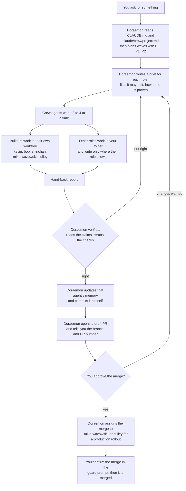
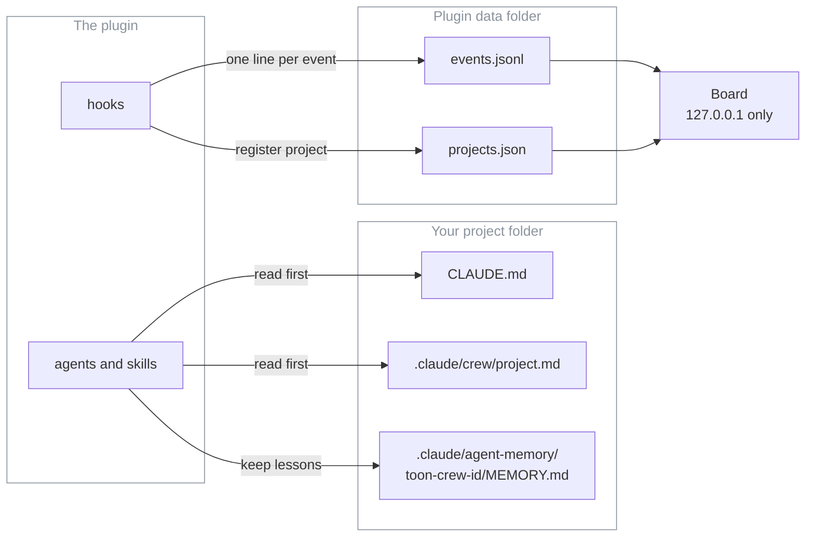
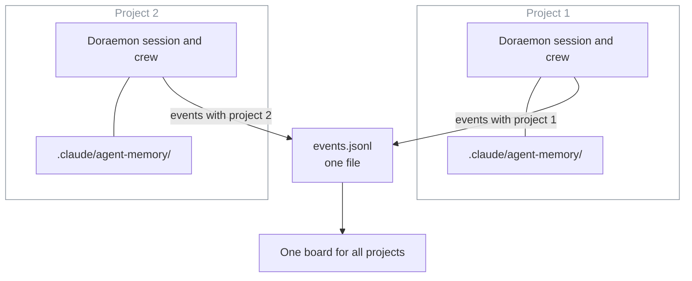
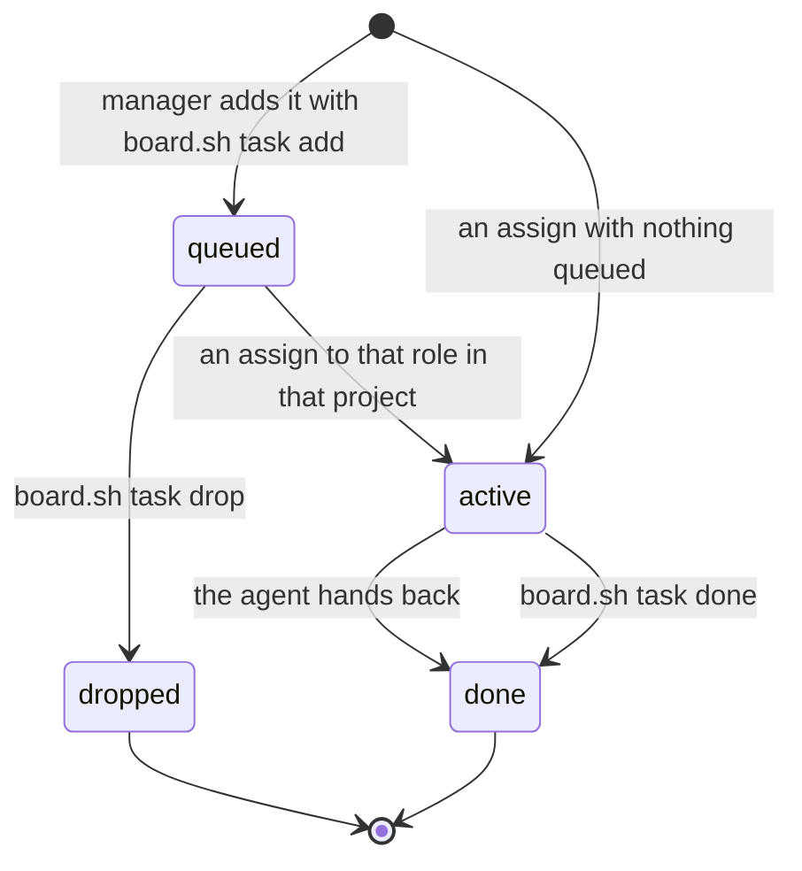

# How the toon crew works

For the owner, and for anyone who has installed the `toon-crew` plugin. After reading this you can follow a piece of work from your request to a merged pull request, and know where the crew keeps its notes.

Words used here:
- **Crew**: the agents in this plugin. Each has one job. Call them as `toon-crew:<id>`.
- **Wave**: a group of tasks that can run at the same time because no two of them touch the same file.
- **Hand-back**: the report an agent gives when it finishes.
- **Worktree**: a separate copy of the repo on disk, so a builder cannot disturb your working folder.
- **Board**: the local status page. It shows who is doing what.

Some parts below are marked **board v2**. That is planned, not released: the plan is in `docs/planning/board-v2-contract.md` and the code is being built now. Nothing marked board v2 works in the installed plugin yet.

## 1. The flow

Doraemon is the main agent. You talk to him; he talks to everyone else.

What to know:
- **P0, P1, P2.** P0 blocks a release or the critical path. P1 is important next. P2 is nice to have. Doraemon gives every task one.
- **Assigned by skill, not by who is free.** If the right role is busy, the task waits, or a second copy of the same role takes it on different files.
- **Only Doraemon commits.** Builders leave their changes uncommitted in the worktree and name it in the hand-back. Doraemon reviews the diff, brings it into the working branch and commits it.
- **Only Doraemon starts crew agents.** Dekisugi may start `toon-crew:olaf` or `toon-crew:stuart` for narrow questions. The guard refuses every other case.
- **Nobody merges without you.** Only Mike Wazowski and Sulley may merge, and only a pull request you approved. The guard asks you to confirm each merge. You can always merge yourself on GitHub.

Sources: `plugin/agents/doraemon.md` ("When invoked", "Assigning work", "Worktrees", "Committing and PRs"), `docs/roster.md` ("Safety by design").

## 2. Teams and roles

Fifteen agents in nine teams. The model tier is the `model` in each agent file.

| Team | Id | Role | Model |
|---|---|---|---|
| Management | `doraemon` | Engineering Manager: plans, briefs, verifies, commits, opens PRs | opus |
| Management | `miguel-rivera` | Knowledge Manager: weekly lessons pass | sonnet |
| Frontend | `nobita` | UX & Design Lead: journey reviews, design direction (review only) | opus |
| Frontend | `shinchan` | Frontend Developer: screens to a design | sonnet |
| Backend | `kevin` | Backend Lead: data, auth, secrets, APIs, integrations, background jobs | opus |
| Backend | `bob` | Backend Developer: modules and routes from a spec | sonnet |
| DevOps | `mike-wazowski` | DevOps Engineer: CI, builds, Docker, local stack; carries out merges | sonnet |
| DevOps | `sulley` | SRE: deploys, rollouts, rollbacks, backups, incidents; carries out merges | sonnet |
| Security | `ninja-hattori` | Security Engineer: attack-style reviews with proof tests (review only) | opus |
| QA | `joe-gardner` | QA Engineer: runs every check, exact counts | haiku |
| QA | `twenty-two` | Exploratory Tester: odd paths, exact repro steps | sonnet |
| Research | `dekisugi` | Research Lead: cited, dated recommendations | opus |
| Research | `olaf` | Research Analyst: evidence tables, fact-checks | sonnet |
| Documentation | `shizuka` | Technical Writer: docs, release notes, proofreading | sonnet |
| Helpers | `stuart` | Code Search Assistant: read-only lookups answered with path:line | haiku |

Good to know:
- **Own worktree:** kevin, bob, shinchan, mike-wazowski, sulley.
- **Read-only roles** (the guard blocks edits to your code): ninja-hattori, joe-gardner, twenty-two, nobita, dekisugi, olaf, stuart. They write only to their own memory file, temporary folders and, for some, a docs folder.
- **Escalation.** Doraemon passes no model when he starts an agent, except `opus` for one run: sulley on production rollout or rollback design, shizuka on launch, trust or privacy copy, and any role after two failed reviews.

More detail (colours, retired characters, the memory folder move from old names): [roster.md](roster.md).

## 3. Where things live

| What | Where | Who uses it |
|---|---|---|
| Project facts: commands, docs per role, no-go areas, deploy rules | `.claude/crew/project.md` (written by the `project-profile` skill) | Every agent reads it first, with `CLAUDE.md` |
| Memory: lessons for this project, one folder per agent | `.claude/agent-memory/toon-crew-<id>/MEMORY.md`, checked into the project | The agent reads it at the start; Doraemon adds lessons from each hand-back |
| The event log: starts, finishes, assignments, commits, PRs | `events.jsonl` in `$CLAUDE_PLUGIN_DATA` (`~/.toon-crew` if the board is started by hand) | Written by the plugin's hooks; read by the board |
| The project list | `projects.json` in the same folder: path, name, first and last seen | Written when a session starts; read by the board and the weekly lessons pass |
| The board | a local page on `127.0.0.1`, started with the `board` skill | You |

How the hooks work:
- A session start, a subagent start or stop, a Bash, Agent or SendMessage call, and a turn end each send one small message to `board/hook.ts`. It appends at most one line to `events.jsonl`.
- The hooks run in the background (`async`), so they cannot slow a session. They add no model tokens.
- Log lines are short and redacted. An assignment keeps only the task's short description, never the full prompt, and a hand-back is cut to 160 characters.
- A separate hook, the guard (`guard.mjs`), checks every risky call before it runs. It is a seatbelt, not a sandbox: the README's "Guards" section lists what it blocks.
- The board starts with `/toon-crew:board`. Polling a project's CI, PRs or deploys is off until you run `/toon-crew:project board on` in that project, and needs a `## Board` section in its `project.md`.

Sources: `plugin/hooks/hooks.json`, `plugin/board/hook.ts`, `plugin/board/lib/paths.ts`, `plugin/board/README.md`, `plugin/skills/{board,project}/SKILL.md`.

## 4. Several projects

Each project runs its own crew. Doraemon in project 1 and Doraemon in project 2 are separate sessions with separate memory. They never share work.

- The plugin and the board are installed once. Memory, `project.md` and sessions belong to each project.
- Every event the hooks write carries the project name, so the board can tell them apart.
- The only thing that crosses projects is a lesson: with `/toon-crew:project lessons on`, the weekly lessons pass reads a project's memory. Only rules tagged `[crew]` move up, and only through a pull request you review. `[project]` facts stay in their project.
- **Board v2 (planned):** a project picker at the top. The picked project is shown in full. The others stay visible as greyed chips with their active count, and one click switches to them. Today the board shows the project with the newest event.

Sources: `plugin/board/README.md`, `plugin/skills/crew-lessons/SKILL.md`, `plugin/board/lib/state.ts:26` (today's focus), `docs/planning/board-v2-contract.md`.

## 5. Active and queued tasks (board v2, planned)

A task is one piece of work for one role in one project. The board works it out from the event log; nothing else is stored.

- **Queued:** the manager runs `board.sh task add --role <id> [--priority P1] "<text>"`. The text is one line, up to 120 characters.
- **Active:** the next assign to that role in that project takes the oldest queued task. If nothing is queued, the assign itself becomes an active task. `board.sh task start <id>` also does it.
- **Done:** the agent's finish event, or `board.sh task done <id>`.
- **Dropped:** hidden from the board.
- The board lists queued tasks by priority (P0, P1, P2, none), then oldest first. It keeps the last 10 done tasks.
- Planned page order: Active, Queued, Crew, Recent, Facts.

Source: `docs/planning/board-v2-contract.md`. Not checked against code, because the code is not written yet: `board.sh` today has only `start`, `stop`, `status`, `export` and `test` (`plugin/board/board.sh:44`).

## 6. Cost in three lines

- The manager is the cost: Doraemon runs on Opus and was 76 to 99 percent of each measured run, so he delegates reading and searching, keeps turns short and sends lookups to Stuart.
- Cheapest model that fits: Opus where a wrong answer looks right (judgement, design review, security), Sonnet for building and writing, Haiku for checks and lookups.
- Nobody passes a `model` on a call except the listed escalations, because a per-call model beats the agent file. The board shows an "override" badge when one does.

Figures and how they were measured: [cost-baseline.md](cost-baseline.md) (taken before the cast v2 renames and not re-measured since). Keep waves 2 to 4 wide: many agents cost many times the tokens of one chat.

## FAQ

**Do I have to run the board?**
No. The hooks write the log whether or not the board is running. The board only reads it.

**Why can a read-only agent still write a file?**
Turning on memory re-adds Write to an agent's tools. The guard is the lock: read-only roles can write only their own memory file, temp folders and their deliverable folders. See "Guards" in the [README](../README.md).

**Can the crew merge to main on its own?**
No. Only Mike Wazowski and Sulley may merge, only a pull request you approved, and the guard asks you to confirm each merge. Pushes to `main` ask you too.

**Does the crew in one project learn from another?**
Not directly. Memory stays in each project. If you turn on `lessons`, a weekly pull request to this repo can carry rules that hold in any project, and you decide what to merge.

**My builder's worktree started from the wrong branch.**
Add `"worktree": { "baseRef": "head" }` to the project's `.claude/settings.json`. Plugin settings cannot set it, and the guard stops the crew editing that file, so make the edit yourself. See "Per-project setup" in the [README](../README.md).
