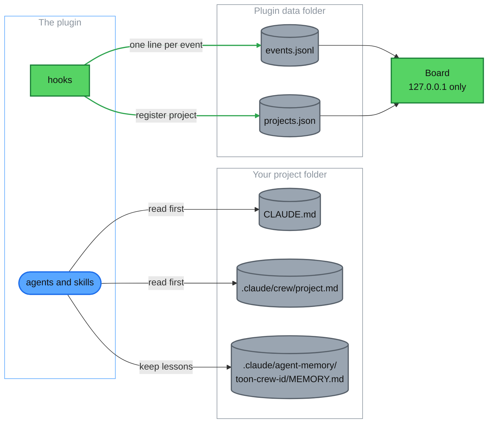
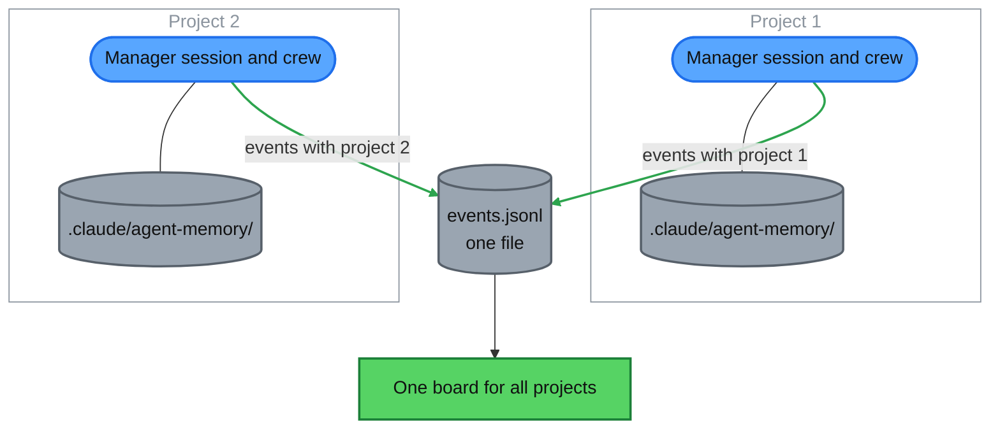
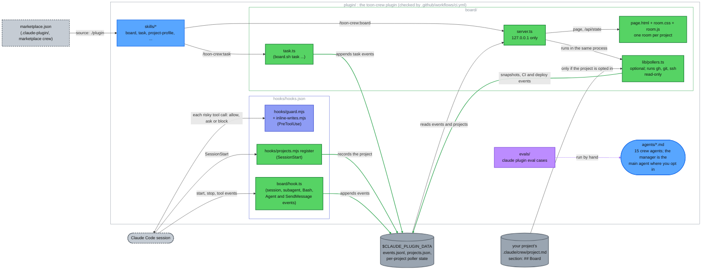

# How the toon crew works

For the owner, and for anyone who has installed the `toon-crew` plugin. After reading this you can follow a piece of work from your request to a merged pull request, know who does what and where the crew keeps its notes, and see what the plugin does and does not do.

## 1. The flow

In a project where you have turned the manager (Doraemon) on ([setup](setup.md#turn-the-manager-on-or-off)), it is the main agent. You talk to the manager; it talks to everyone else. Follow the numbers from top to bottom. The right-hand lane shows what the board records at each step.

```mermaid
flowchart TD
    S1(["(1) 👤 You ask<br/>for something"])
    S2(["(2) The manager<br/>reads project.md<br/>and its memory"])
    S3["(3) It plans waves and<br/>gives every task<br/>P0, P1 or P2"]
    S4["(4) It queues the whole plan<br/>on the board<br/>(toon-crew:task)"]
    S5["(5) It writes the contract<br/>and commits it"]
    S6["(6) It briefs the crew,<br/>2 to 4 at a time"]

    subgraph CREW["(7) The crew works"]
        BE(["Backend<br/>kevin: lead, own worktree<br/>bob: developer, own worktree"])
        FE(["Frontend<br/>nobita: styles and UX review, own worktree<br/>shinchan: behaviour and logic, own worktree"])
        DV(["DevOps<br/>mike-wazowski: CI, own worktree<br/>sulley: SRE, own worktree"])
        SE(["Security<br/>ninja-hattori: review"])
        QA(["QA<br/>joe-gardner: checks<br/>twenty-two: exploratory"])
        RS(["Research<br/>dekisugi: lead<br/>olaf: analyst"])
        DC(["Documentation<br/>shizuka: technical writer"])
        HP(["Helpers<br/>stuart: code search"])
    end

    S8["(8) The crew hand back<br/>(a short report each)"]
    S9{"(9) The manager verifies:<br/>runs the tests,<br/>reads the diffs"}
    S10["(10) It commits the work<br/>(only the manager commits)"]
    S11["(11) It adds lessons to<br/>that agent's memory"]
    S12["(12) It opens a draft PR<br/>and tells you the branch<br/>and PR number"]
    S13{"(13) CI checks<br/>all green?"}
    S14{"(14) You say OK?"}
    S15(["(15) Mike Wazowski merges<br/>(Sulley for a production<br/>rollout) after your confirm"])
    FIX{{"Back to step (6)<br/>with a fix brief<br/>(the loop repeats)"}}
    S16["(16) Release and deploy,<br/>if the project's rules<br/>say a merge does it"]

    S1 --> S2 --> S3 --> S4 --> S5 --> S6 --> CREW --> S8 --> S9
    S9 -->|"fails"| FIX
    S9 -->|"passes"| S10 --> S11 --> S12 --> S13
    S13 -->|"a check fails"| FIX
    S13 -->|"green"| S14
    S14 -->|"changes wanted"| FIX
    S14 -->|"yes"| S15 --> S16

    K1(["Task queued<br/>(Queued list)"])
    K2(["Assign: the task<br/>goes Active"])
    K3(["Hand-back: the task<br/>is done"])
    K4(["Commit logged"])
    K5(["PR opened"])
    K6(["PR merged"])

    S4 -.->|"board.sh task add"| K1
    S6 -.->|"hook"| K2
    S8 -.->|"hook"| K3
    S10 -.->|"hook"| K4
    S12 -.->|"hook"| K5
    S15 -.->|"hook"| K6

    BE ~~~ QA
    FE ~~~ RS
    DV ~~~ DC
    SE ~~~ HP

  classDef mgmt fill:#58a6ff,stroke:#1f6feb,color:#111,stroke-width:2px
  classDef backend fill:#e3b341,stroke:#9a6700,color:#111,stroke-width:2px
  classDef frontend fill:#ff7b72,stroke:#cf222e,color:#111,stroke-width:2px
  classDef devops fill:#39c5cf,stroke:#0e7490,color:#111,stroke-width:2px
  classDef security fill:#8e9cf5,stroke:#4c5bd4,color:#111,stroke-width:2px
  classDef qa fill:#bc8cff,stroke:#8250df,color:#111,stroke-width:2px
  classDef research fill:#f0883e,stroke:#bc4c00,color:#111,stroke-width:2px
  classDef docs fill:#f778ba,stroke:#bf3989,color:#111,stroke-width:2px
  classDef helpers fill:#c9b97a,stroke:#8a7a3a,color:#111,stroke-width:2px
  classDef crew fill:#b1bac4,stroke:#57606a,color:#111,stroke-width:2px
  classDef data fill:#9aa5b1,stroke:#57606a,color:#111,stroke-width:2px
  classDef board fill:#56d364,stroke:#1a7f37,color:#111,stroke-width:2px
  classDef ext fill:#c5ccd4,stroke:#57606a,color:#111,stroke-width:2px,stroke-dasharray:5 3
    classDef fix fill:#ffa198,stroke:#cf222e,color:#111,stroke-width:2px,stroke-dasharray:5 3
    class S1 ext
    class S2,S3,S4,S5,S6,S8,S10,S11,S12 mgmt
    class S9,S13,S14 crew
    class FIX fix
    class S15,S16 devops
    class K1,K2,K3,K4,K5,K6 board
    class BE backend
    class FE frontend
    class DV devops
    class SE security
    class QA qa
    class RS research
    class DC docs
    class HP helpers
    style CREW fill:transparent,stroke:#8b949e,color:#8b949e
    %% dotted edges = what the board records
    linkStyle 18,19,20,21,22,23 stroke:#2da44e,stroke-width:2px
```

Colours are the same in every diagram in this repo. Dashed grey is you or something outside the plugin (such as GitHub), blue is the manager's own work, grey diamonds are checks, red with a dashed edge is the loop back, and green is the Crew Room board. The crew boxes use one colour per team: Backend gold, Frontend red, DevOps cyan, Security indigo, QA purple, Research orange, Documentation pink, Helpers khaki. The green dotted lines are what the board records: hooks write one line to the event log and the board reads it (section 3). Step 4 is not a hook: `board.sh task add` writes the queued task itself.

What to know:
- **P0, P1, P2.** P0 blocks a release or the critical path. P1 is important next. P2 is nice to have. The manager gives every task one.
- **Assigned by skill, not by who is free.** If the right role is busy, the task waits, or a second copy of the same role takes it on different files.
- **Only the manager commits.** Builders leave their changes uncommitted in the worktree and name it in the hand-back. The manager reviews the diff, brings it into the working branch and commits it. It checks the memory notes for secrets and commits them with the work.
- **Nobody merges without you.** Only Mike Wazowski and Sulley may merge, and only a pull request you approved. You can always merge yourself on GitHub. The rules are in [guards.md](guards.md#the-rules).
- **What step 16 means depends on the project.** The plugin does not deploy anything. If a project's `project.md` says a merge to `main` releases and deploys, that happens after step 15; Sulley handles production rollouts and rollbacks.

Words used here:
- **Crew**: the agents in this plugin. Each has one job. Call them as `toon-crew:<id>`.
- **Wave**: a group of tasks that can run at the same time because no two of them touch the same file.
- **Hand-back**: the report an agent gives when it finishes.
- **Worktree**: a separate copy of the repo on disk, so a builder cannot disturb your working folder.
- **Board**: the local status page. It shows who is doing what ([the Crew Room guide](crew-room.md)).

Sources: `plugin/agents/doraemon.md` ("When invoked", "Assigning work", "Worktrees", "Verifying hand-backs", "Committing and PRs", "Memory duty"), `plugin/skills/task/SKILL.md`, `plugin/board/hook.ts` (commit and PR events).

### Parallel work: waves and copies

The manager runs the crew in waves, and it can run two copies of one role. The rules are in `plugin/agents/doraemon.md`.

- **Waves are 2-4 crew wide for light work, 6-8 for heavy work.** Several agents at once cost many times the tokens of one chat, so it keeps each wave small. No two tasks in a wave write the same file.
- **A role can have a second copy.** If the right role is busy, the manager queues the task or starts a second copy of that role on different files, for example two Shinchans on two screens. It never gives the task to a different role just because it is idle. Because the files are different, the copies never overwrite each other.
- **The whole plan is queued up front.** Every piece of every wave, plus reviews, QA runs and the merge step, goes on the board with `toon-crew:task` before work starts. The Queued list shows what is coming.
- **Each copy takes the oldest queued task for its role.** When an agent starts, the board moves that role's oldest queued task to Running. When the agent stops, the task is done. If the plan changes, the manager drops the task so nothing stale stays queued.
- **On the Crew Room:** a "Crew 3 / 4" meter shows how many agents are running. When the manager starts a copy, it uses its copy-light gadget: a twin appears at the desk with a ×2 badge. See [the Crew Room guide](crew-room.md).

Sources: `plugin/agents/doraemon.md` (step 6 "queue the whole plan", "Assigning work", "Cost rules"), `plugin/board/lib/tasks.ts` (an assign takes the role's oldest queued task).

## 2. Teams and roles

Fifteen agents in nine teams, one job each. Every agent reads the project's `CLAUDE.md` and `.claude/crew/project.md` first. The agent files in `plugin/agents/` are the source of truth; the table shows their settings. Model tier is the `model` field.

| Team | Id (name, from) | Job | Model · effort · max turns | Colour |
|---|---|---|---|---|
| Management | `doraemon` (Doraemon, Doraemon) | Engineering Manager: main agent; plans waves, assigns by team and title, verifies, commits, opens PRs | opus · high · none set | blue |
| Management | `miguel-rivera` (Miguel Rivera, Coco) | Knowledge Manager: lessons pass (started by hand), confirmed crew records | sonnet · low · 30 | orange |
| Frontend | `nobita` (Nobita, Doraemon) | UX & Design Lead: design direction, styles and visual assets (own worktree, edits style files only), journey reviews with ranked findings | opus · high · 80 | yellow |
| Frontend | `shinchan` (Shinchan + Shiro, Crayon Shin-chan) | Frontend Developer: behaviour and logic to a design, two screenshot rounds | sonnet · medium · 60 | red |
| Backend | `kevin` (Kevin, Minions) | Backend Lead: data, auth, secrets, APIs, integrations, guardrails, background jobs | opus · high · 80 | yellow |
| Backend | `bob` (Bob, Minions) | Backend Developer: modules and routes from specs, ports with parity tests, lint and type fixes | sonnet · medium · 60 | blue |
| DevOps | `mike-wazowski` (Mike Wazowski, Monsters University) | DevOps Engineer: CI, builds, Docker and images, local stack, setup scripts; carries out merges | sonnet · high · 100 | cyan |
| DevOps | `sulley` (Sulley, Monsters University) | SRE: deploys, rollouts, rollbacks, backups, monitoring, incidents; carries out merges | sonnet · high · 100 | purple |
| Security | `ninja-hattori` (Ninja Hattori + Shishimaru, Ninja Hattori-kun) | Security Engineer: attack-style reviews with proof tests (review only) | opus · high · 80 | blue |
| QA | `joe-gardner` (Joe Gardner, Soul) | QA Engineer: every suite three times, no-services run, lint, typecheck, exact counts | haiku · low · 40 | purple |
| QA | `twenty-two` (22, Soul) | Exploratory Tester: edge cases, odd paths, browser walk-throughs, exact repro steps (never fixes) | sonnet · medium · 40 | cyan |
| Research | `dekisugi` (Dekisugi, Doraemon) | Research Lead: product, UX and technical research with cited, dated sources | opus · high · 80 | orange |
| Research | `olaf` (Olaf, Frozen) | Research Analyst: evidence tables and fact-checks, a link and date per row | sonnet · medium · 40 | cyan |
| Documentation | `shizuka` (Shizuka, Doraemon) | Technical Writer: docs, release notes, launch copy, drafts, proofreading | sonnet · high · 60 | pink |
| Helpers | `stuart` (Stuart, Minions) | Code Search Assistant: quick read-only lookups answered with path:line (the default for lookups) | haiku · low · 15 | yellow |

### How the roles are set up

- **Own worktree** (`isolation: worktree`): kevin, bob, shinchan, nobita, mike-wazowski, sulley. Set `worktree.baseRef` so their worktrees start from your working branch ([setup](setup.md#recommended-make-builders-start-from-your-branch)).
- **Nobita edits styles:** `tools` includes Edit, and `disallowedTools` keeps MultiEdit, NotebookEdit, Agent and the relay tools. Its prompt limits edits to style and visual files (CSS, tokens, sprites, images, `docs/design/`).
- **Read-only roles:** ninja-hattori, joe-gardner, twenty-two, dekisugi, olaf, stuart. Each has a fixed `tools` list plus `disallowedTools: Edit, MultiEdit, NotebookEdit, SendMessage, CronCreate, Workflow, RemoteTrigger`, and `Agent` for all but dekisugi.
  - stuart: Read, Grep, Glob. joe-gardner and twenty-two: Read, Grep, Glob, Bash, Write. ninja-hattori: the same plus Skill. olaf: Read, Grep, Glob, Write and the web tools. dekisugi: olaf's tools plus Agent.
  - `memory: project` adds Write back to a tool list, so these prompts tell the agent to read its memory file and write it back whole. The guard, not the list, keeps these roles read-only: [what it allows them to write](guards.md#the-rules).
- **Who may merge, push, approve, spawn agents or use relay tools** is a guard rule, not a role setting: see [guards.md](guards.md#who-is-who).
- **Models.** A per-call model beats the agent file, so the manager passes none, except `opus` for one run: sulley on production rollout or rollback design, shizuka on launch, trust or privacy copy, and any role after two failed reviews.

### Skills the crew uses

| Skill | Used by | What it holds |
|---|---|---|
| `project-profile` | doraemon (first run, or when stale) | Writes `.claude/crew/project.md`: commands, docs per role, no-go areas, git, deploy rules, optional Board section |
| `security-backend` | kevin and ninja-hattori (preloaded), bob (for routes and personal data) | Data scoping, isolation tests, sessions, sign-in, encryption, consent, export and delete, safe errors |
| `integrations` | kevin and ninja-hattori (preloaded), bob (for third-party APIs) | Read-only by default, allow-lists and host pinning, scopes and keys, rate limits, paging caps, redaction, background jobs, commit-time re-checks |
| `crew-lessons` | miguel-rivera (when the owner starts the pass) | The lessons harvest and promotion procedure |

The commands you type most (`/toon-crew:board`, `handbacks`, `project`, `compact-setup`) are in the [README](../README.md#commands); the other skills, including `task` and `forget`, are in [Setup](setup.md#other-skills).

## 3. Where things live

| What | Where | Who uses it | Who can see it |
|---|---|---|---|
| Project facts: commands, docs per role, no-go areas, deploy rules | `.claude/crew/project.md` (written by the `project-profile` skill) | Every agent reads it first, with `CLAUDE.md` | Your team, once you commit it |
| Memory: lessons for this project, one folder per agent | `.claude/agent-memory/toon-crew-<id>/MEMORY.md`, checked into the project | The agent reads it at the start; the manager adds lessons from each hand-back. The guard blocks any lesson that looks like a key, token or password | Your team, once you commit it |
| The event log: starts, finishes, assignments, commits, PRs | `events.jsonl` in `$CLAUDE_PLUGIN_DATA` (an absolute folder; the board does nothing without it) | Written by the plugin's hooks; read by the board | Only you, on this machine |
| The project list | `projects.json` in the same folder: path, name, first and last seen | Written when a session starts; read by the board and the lessons pass | Only you, on this machine |
| Hand-back reports and summaries | `projects/<project>/handbacks/` in the same folder (see below) | Written by each crew agent; the manager reads the summaries | Only you, on this machine |
| Shared crew lessons | `docs/lessons/` in this repo | Written by the owner-only lessons pass | The repo owner, by pull request |
| The board | a local page on `127.0.0.1`, started with the `board` skill | You | You |

Hand-backs: when a crew member finishes, it writes two files in the project's folder under `projects/<project>/handbacks/` in the plugin data folder: the full report in `full/<agent>/` and a 12-line summary in `summaries/<agent>/`. Only the summary comes back into the manager's conversation. The reason is cost: the manager re-sends its whole conversation on every turn, so a long report in the chat is paid for again and again, while a file is not. The files survive `/clear` and new sessions, so the manager can read the summaries whenever it needs them. When something in a summary looks missing, it opens the full report and anything else it needs. The folders stay on your machine, and the board deletes files older than 60 days. The format is in `docs/specs/handbacks.md`.

How the hooks work:
- A session start, a subagent start or stop, a Bash, Agent or SendMessage call, and a turn end each send one small message to `board/hook.ts`. It appends at most one line to `events.jsonl`.
- The hooks run in the background (`async`), so they cannot slow a session. They add no model tokens.
- A separate hook, the guard (`guard.mjs`), checks every risky call before it runs. It is a seatbelt, not a sandbox: [guards.md](guards.md) lists what it blocks.
- The board starts with `/toon-crew:board` ([the Crew Room guide](crew-room.md)). Polling a project's CI, PRs or deploys is off until you opt in ([setup](setup.md#optional-show-ci-pull-requests-commits-and-deploys-on-the-board)).

What is kept and who can see it is in [section 7](#7-what-it-does-and-does-not-do).

Sources: `plugin/hooks/hooks.json`, `plugin/board/hook.ts`, `plugin/board/lib/paths.ts`, `plugin/board/README.md`, `plugin/skills/{board,project}/SKILL.md`.

## 4. Several projects

Each project runs its own crew. The manager in project 1 and the manager in project 2 are separate sessions with separate memory. They never share work.

- The plugin and the board are installed once. Memory, `project.md` and sessions belong to each project.
- Every event the hooks write carries the project name, so the board can tell them apart; the picker on the page is in [the Crew Room guide](crew-room.md#the-project-picker).
- The only thing that crosses projects is a lesson: with `/toon-crew:project lessons on`, the lessons pass (owner-only, started by hand) reads a project's memory. Only rules tagged `[crew]` move up, and only through a pull request you review. `[project]` facts stay in their project.

Sources: `plugin/board/README.md`, `plugin/skills/crew-lessons/SKILL.md`.

## 5. Cost in three lines

Measured once, in October 2026, on an early version (0.1.0) and not re-measured since the cast was renamed.

- The manager is the cost: it runs on Opus and was 76 to 99 percent of each measured run, so it delegates reading and searching, keeps turns short and sends lookups to Stuart.
- Cheapest model that fits: Opus where a wrong answer looks right (judgement, design review, security), Sonnet for building and writing, Haiku for checks and lookups.
- Nobody passes a `model` on a call except the escalations in section 2.
- To keep the manager's context useful when it compacts, `/toon-crew:compact-setup` adds an editable "Compact instructions" section to your CLAUDE.md (see `plugin/skills/compact-setup/SKILL.md`).

Keep waves 2 to 4 wide: many agents cost many times the tokens of one chat.

## 6. How the parts fit together

The plugin's files, the hooks, the board and where data moves between them. The solid arrows are calls and data; the dashed arrow is something you run by hand.

Claude Code loads the plugin from the marketplace and runs the hooks around every session. The manager becomes the main agent only in projects where you opt in. The guard hook checks each risky tool call before it runs. The other hooks only write: a project list and a one-line-per-event log in the plugin's data folder. The `task` skill writes to the same log: the manager uses it to queue the whole plan up front and to drop pieces when the plan changes.

The Crew Room board is a separate local page. `board.sh start` runs `server.ts` on `127.0.0.1`; it reads the log and serves the page, which shows one room per project. Only if you opt a project in (`/toon-crew:project board on`) and the project's `project.md` has a `## Board` section does it also poll GitHub CI, pull requests, commits and a deploy host, read-only.

## 7. What it does and does not do

### What it does

- Gives a project a manager when you turn it on there. It plans, briefs the crew, checks every hand-back and opens the pull request ([section 1](#1-the-flow)).
- Runs six builders in their **own git worktrees** and keeps six roles **read-only** ([section 2](#2-teams-and-roles)).
- Checks risky Bash, file, agent and MCP calls with the **guard** before they run, and fails closed: if it cannot decide, it blocks. It asks you before a merge, a push to `main`, or an edit of a project's `.claude/hooks`, `agents`, `skills` or `commands` ([guards.md](guards.md)).
- Shows the **Crew Room** on `127.0.0.1` ([the Crew Room guide](crew-room.md)).
- Keeps one memory folder per agent and one shared `project.md` in your project ([section 3](#3-where-things-live)).

### What it does not do

- **It is not a sandbox, and it does not check your own commands.** Both are in [guards.md](guards.md#what-the-guard-cannot-do).
- **Nobody merges on their own.** No auto-merge and no admin merge, for any role. [guards.md](guards.md#the-rules) has who may merge and push to `main`.
- **It deploys nothing** unless your project's own rules make a merge deploy (step 16).
- **The board has no remote view, no login and no buttons,** and does not start by itself ([the Crew Room guide](crew-room.md#good-to-know)).
- **Polling is off until you turn it on** for a project, and a project's own files cannot turn it on. It supports GitHub (through `gh`) and one SSH deploy host only: no GitLab, no cloud provider APIs. Commits are read from local refs; it does not fetch. Deploy status needs a result file in a fixed format, and app errors come from the `docker logs` of the containers you name.
- **The event log is trimmed only while the board runs.** When the board starts, and then once a day, it drops events older than 30 days (turn ends and manager heartbeats after one day), keeps only the newest usage line for each session and agent, and keeps the events of any task still queued or active. If you never start the board, the log only grows. How large it gets in practice has not been measured.
- **The board shows plan usage, not a bill.** On a Pro or Max plan, the Plan usage panel shows your 5-hour and weekly limits and each agent's share of that usage (added in 0.3.13; the limits need Claude Code 2.1.287 or later). API users get a dollar ledger instead ([CHANGELOG.md](../CHANGELOG.md)).
- **Projects never share memory.** Only `[crew]` rules move up, through a pull request the owner merges ([section 4](#4-several-projects)). The lessons pass is owner-only and manual, with no schedule, and needs `gitleaks`.
- **The evals are not run in CI.** CI runs the structure check, strict validation, the hook and board tests and a secrets scan (`.github/workflows/ci.yml`). The eval cases are run by hand and have not been re-measured since the cast was renamed.
- **No Windows or Linux desktop setup is documented.** `board.sh` is bash. CI runs on Ubuntu; the evals ran on macOS.
- **The code is MIT licensed; the characters are not ours.** See [LICENSE](../LICENSE). Character names and likenesses belong to their owners, and this is an unofficial fan project ([NOTICE](../NOTICE)).

### Privacy and your data

- **The plugin has no server and sends nothing by itself.** Claude Code talks to Anthropic as it always does. The board runs on your machine.
- **The event log and project list** live in the plugin's data folder (`$CLAUDE_PLUGIN_DATA`, an absolute folder; the board does nothing without it). Files are mode 0600 and folders 0700.
- **Log lines are short and redacted.** The board redacts secrets, one-time codes, addresses and emails before a line reaches disk or the page. An assignment keeps only the task's short description, never the full prompt, and a hand-back is cut to 160 characters.
- **The project list** holds each project's path, name, first and last seen, and two opt-in flags. It never holds secrets. `/toon-crew:forget` removes a project. Uninstalling removes the data folder by Claude Code's default.
- **Memory and `project.md` live in your project** and are meant to be checked in. The guard blocks obvious secrets (keys, tokens, passwords, emails, phone and card numbers) from being written into memory files. It does not scan `project.md`, so read it before you commit it.
- **Polling talks to GitHub and your deploy host only if you opt a project in.** It runs `gh` and a read-only `ssh` on your machine.
- **Lessons leave a project only through a pull request** that the owner of this repo reviews and merges. Only `[crew]` rules move; `[project]` facts stay.
