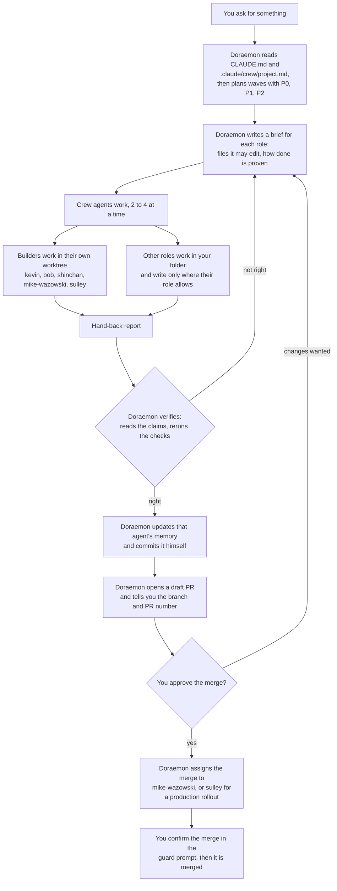
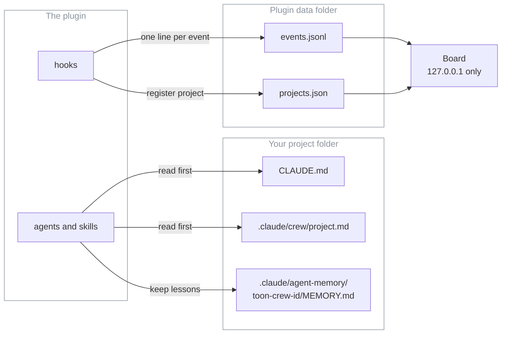
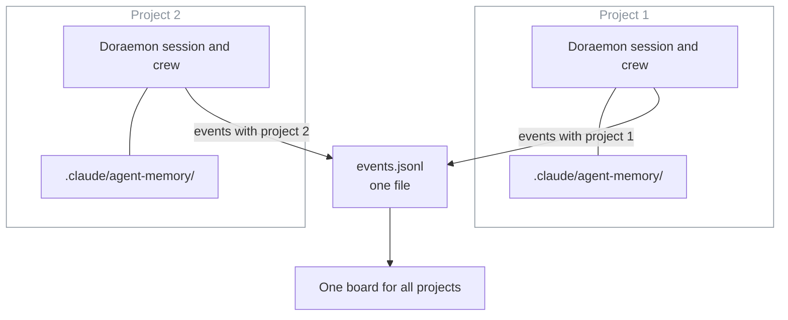
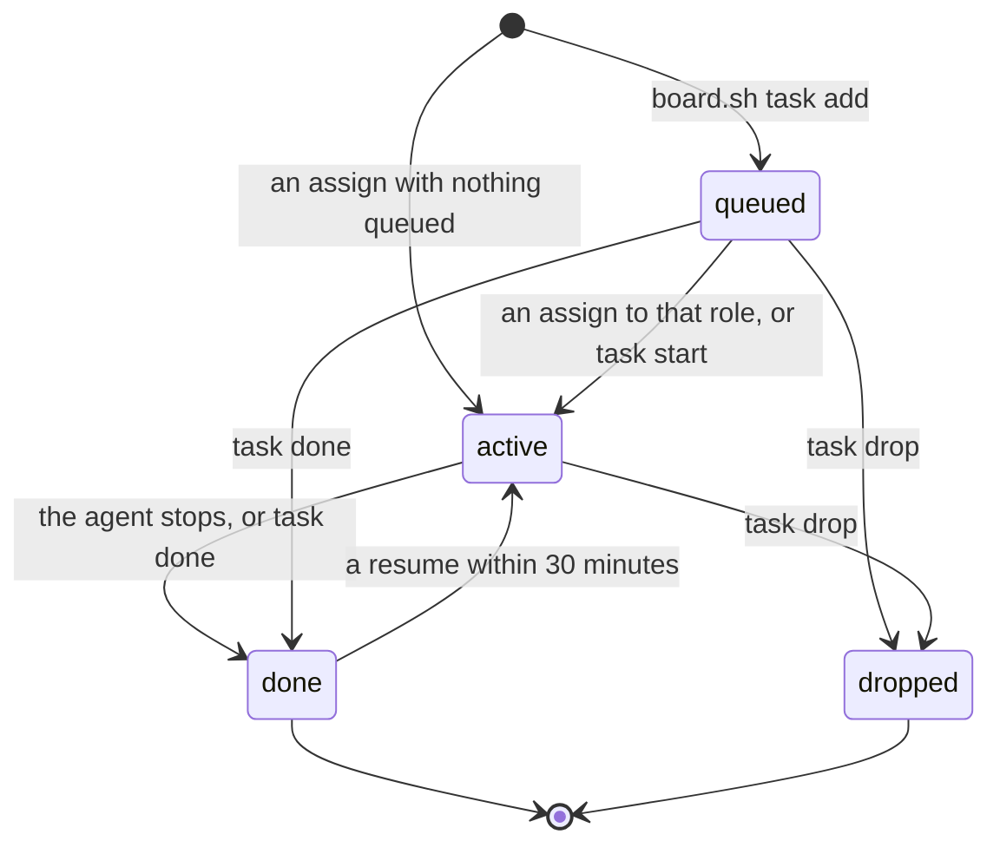

# How the toon crew works

For the owner, and for anyone who has installed the `toon-crew` plugin. After reading this you can follow a piece of work from your request to a merged pull request, and know where the crew keeps its notes.

Words used here:
- **Crew**: the agents in this plugin. Each has one job. Call them as `toon-crew:<id>`.
- **Wave**: a group of tasks that can run at the same time because no two of them touch the same file.
- **Hand-back**: the report an agent gives when it finishes.
- **Worktree**: a separate copy of the repo on disk, so a builder cannot disturb your working folder.
- **Board**: the local status page. It shows who is doing what.

Sections 4, 5 and 6 describe **board v2**: the project picker, the Active and Queued lists and `board.sh task`. It is built (the contract is `docs/planning/board-v2-contract.md`), but it needs plugin version 0.3.0 or later. To check your install, run `board.sh task list`: an older plugin prints a usage line and exits with an error instead of a list.

## 1. The flow

Doraemon is the main agent. You talk to him; he talks to everyone else.



What to know:
- **P0, P1, P2.** P0 blocks a release or the critical path. P1 is important next. P2 is nice to have. Doraemon gives every task one.
- **Assigned by skill, not by who is free.** If the right role is busy, the task waits, or a second copy of the same role takes it on different files.
- **Only Doraemon commits.** Builders leave their changes uncommitted in the worktree and name it in the hand-back. Doraemon reviews the diff, brings it into the working branch and commits it.
- **Only Doraemon starts crew agents.** Dekisugi may start `toon-crew:olaf` or `toon-crew:stuart` for narrow questions. The guard refuses every other case.
- **Nobody merges without you.** Only Mike Wazowski and Sulley may merge, and only a pull request you approved. The guard asks you to confirm each merge. You can always merge yourself on GitHub.

Sources: `plugin/agents/doraemon.md` ("When invoked", "Assigning work", "Worktrees", "Committing and PRs"), `docs/roster.md` ("Safety by design").

## 2. Teams and roles

Fifteen agents in nine teams. The model tier is the `model` in each agent file.

| Team | Id | Role | Model |
|---|---|---|---|
| Management | `doraemon` | Engineering Manager: plans, briefs, verifies, commits, opens PRs | opus |
| Management | `miguel-rivera` | Knowledge Manager: weekly lessons pass | sonnet |
| Frontend | `nobita` | UX & Design Lead: journey reviews, design direction (review only) | opus |
| Frontend | `shinchan` | Frontend Developer: screens to a design | sonnet |
| Backend | `kevin` | Backend Lead: data, auth, secrets, APIs, integrations, background jobs | opus |
| Backend | `bob` | Backend Developer: modules and routes from a spec | sonnet |
| DevOps | `mike-wazowski` | DevOps Engineer: CI, builds, Docker, local stack; carries out merges | sonnet |
| DevOps | `sulley` | SRE: deploys, rollouts, rollbacks, backups, incidents; carries out merges | sonnet |
| Security | `ninja-hattori` | Security Engineer: attack-style reviews with proof tests (review only) | opus |
| QA | `joe-gardner` | QA Engineer: runs every check, exact counts | haiku |
| QA | `twenty-two` | Exploratory Tester: odd paths, exact repro steps | sonnet |
| Research | `dekisugi` | Research Lead: cited, dated recommendations | opus |
| Research | `olaf` | Research Analyst: evidence tables, fact-checks | sonnet |
| Documentation | `shizuka` | Technical Writer: docs, release notes, proofreading | sonnet |
| Helpers | `stuart` | Code Search Assistant: read-only lookups answered with path:line | haiku |

Good to know:
- **Own worktree:** kevin, bob, shinchan, mike-wazowski, sulley.
- **Read-only roles** (the guard blocks edits to your code): ninja-hattori, joe-gardner, twenty-two, nobita, dekisugi, olaf, stuart. They write only to their own memory file, temporary folders and, for some, a docs folder.
- **Escalation.** Doraemon passes no model when he starts an agent, except `opus` for one run: sulley on production rollout or rollback design, shizuka on launch, trust or privacy copy, and any role after two failed reviews.

More detail (colours, retired characters, the memory folder move from old names): [roster.md](roster.md).

## 3. Where things live



| What | Where | Who uses it |
|---|---|---|
| Project facts: commands, docs per role, no-go areas, deploy rules | `.claude/crew/project.md` (written by the `project-profile` skill) | Every agent reads it first, with `CLAUDE.md` |
| Memory: lessons for this project, one folder per agent | `.claude/agent-memory/toon-crew-<id>/MEMORY.md`, checked into the project | The agent reads it at the start; Doraemon adds lessons from each hand-back |
| The event log: starts, finishes, assignments, commits, PRs | `events.jsonl` in `$CLAUDE_PLUGIN_DATA` (`~/.toon-crew` if the board is started by hand) | Written by the plugin's hooks; read by the board |
| The project list | `projects.json` in the same folder: path, name, first and last seen | Written when a session starts; read by the board and the weekly lessons pass |
| The board | a local page on `127.0.0.1`, started with the `board` skill | You |

How the hooks work:
- A session start, a subagent start or stop, a Bash, Agent or SendMessage call, and a turn end each send one small message to `board/hook.ts`. It appends at most one line to `events.jsonl`.
- The hooks run in the background (`async`), so they cannot slow a session. They add no model tokens.
- Log lines are short and redacted. An assignment keeps only the task's short description, never the full prompt, and a hand-back is cut to 160 characters.
- A separate hook, the guard (`guard.mjs`), checks every risky call before it runs. It is a seatbelt, not a sandbox: the README's "Guards" section lists what it blocks.
- The board starts with `/toon-crew:board`. Polling a project's CI, PRs or deploys is off until you run `/toon-crew:project board on` in that project, and needs a `## Board` section in its `project.md`.

Sources: `plugin/hooks/hooks.json`, `plugin/board/hook.ts`, `plugin/board/lib/paths.ts`, `plugin/board/README.md`, `plugin/skills/{board,project}/SKILL.md`.

## 4. Several projects

Each project runs its own crew. Doraemon in project 1 and Doraemon in project 2 are separate sessions with separate memory. They never share work.



- The plugin and the board are installed once. Memory, `project.md` and sessions belong to each project.
- Every event the hooks write carries the project name, so the board can tell them apart.
- The only thing that crosses projects is a lesson: with `/toon-crew:project lessons on`, the weekly lessons pass reads a project's memory. Only rules tagged `[crew]` move up, and only through a pull request you review. `[project]` facts stay in their project.
- **The project picker.** The board has a row of chips at the top, one per project plus **All projects**. The picked chip has a solid border; the others are greyed with a dashed border. Every chip shows how many tasks are active in that project ("2 active"). One click switches. Active, Queued, Crew, Recent and Facts then show only the picked project. With **All projects**, each row also names its project.
- **Which project is picked first.** In this order: the `?project=` value in the page address, the project you picked last time (the page keeps it in your browser), the project with the newest event (or the first registered project if no event names one), then **All projects**. While the page stays open it keeps your pick.

Sources: `plugin/board/README.md`, `plugin/skills/crew-lessons/SKILL.md`, `plugin/board/room.js:156-170` (picker order), `room.js:219-233` (chips), `room.js:284-301` (filtering), `plugin/board/room.css:45-50` (greyed and picked chips), `plugin/board/lib/state.ts:27` (newest event).

## 5. Active and queued tasks

A task is one piece of work for one role in one project. The board works it out from the event log; nothing else is stored.



The commands (run them as shown in section 6):

```bash
board.sh task add --role <id> [--priority P0|P1|P2] [--ref <branch|PR>] "<text>"
board.sh task start <id>
board.sh task done <id> [--ref <branch|PR>]
board.sh task drop <id>
board.sh task list [--all] [--json]
```

- **Queued.** `add` prints `queued t-<number>-<hex>`; that is the task id. The role must be one of the 15 crew ids, or `add` refuses and lists them. `--priority` is optional; any other value is refused. The text is one line: extra spaces are folded, secrets are redacted, then it is cut to 120 characters. A longer text is cut, not refused. `--ref` (a branch or PR) is cut to 80.
- **Active.** An assign (Doraemon starting that role in that project) takes the **oldest** queued task for that role and project, whatever its priority. If nothing is queued, the assign itself becomes an active task, with its short description as the text and no priority. `task start <id>` does the same for one queued task by hand.
- **Done.** The role's stop event finishes the oldest active task for that role in that project. `task done <id>` does it by hand, for a queued or an active task.
- **Dropped.** `task drop <id>` works on a queued or an active task and hides it. `task start` works only on a queued task. A task that is already done or dropped is refused with "is already done" (or "dropped"), and an unknown id with "no task".
- **Resume.** A message to an existing agent (SendMessage) does not make a new task. If that role finished a task in the same project within the last 30 minutes, the latest one goes back to active. Otherwise nothing changes.
- **Late assign.** An assign that arrives within 5 seconds after the same role stopped in the same project is ignored, unless that role started again in between. A foreground agent call reports its assign just after the agent has stopped; without this rule it would show as a second task.
- **Order.** Active tasks are oldest first. Queued tasks are by priority (P0, P1, P2, then none), then oldest first. The board keeps the last 10 done tasks, newest first.
- **Where you see them.** The page shows Active and Queued. The done tasks are in `board.sh task list` and in `/api/state`; the page's Recent section shows hand-backs, PRs and deploys instead (section 6).
- **Model override.** An active task shows `model override: <name>` when the call asked for a model that differs from the agent file's.

Sources: `plugin/board/task.ts:34-74` (commands, refusals), `plugin/board/lib/tasks.ts:17-27` (priorities, 120 characters, 10 done, 30 minutes, 5 seconds), `tasks.ts:34-82` (states and rules), `tasks.ts:84-93` (order). Checked by running `board.sh task add|list|start|done|drop` against a throwaway data folder: the 150-character text came back as 120, `P9` and an unknown role were refused, and a second `start` or `done` said "already".

## 6. Using the board

Start it once; one board serves every project:

- Type `/toon-crew:board` (it takes `start`, `stop` or `status`; the default is `start`). It prints `{"pid":..,"port":..}`. Open `http://127.0.0.1:<port>`. The port is the first free one from 8811. The skill is set so that only you can run it (`disable-model-invocation: true`).
- Without the skill, run the command it runs: `CLAUDE_PLUGIN_DATA="${CLAUDE_PLUGIN_DATA}" bash "${CLAUDE_PLUGIN_ROOT}/board/board.sh" start`. Use the same data folder as the hooks, or the board shows nothing.

The page refreshes every 4 seconds. The status in the header says "Live" with the time, or "Not answering" if the board has stopped; the last data stays on screen.

What each section means (pick a project with the chips first, section 4):

| Section | What it shows |
|---|---|
| **Active** | Tasks being worked now: who, the task text, and how long it has been going. A `P0`, `P1` or `P2` chip, a branch or PR, and a model override show when set. |
| **Queued** | Tasks waiting for a role, by priority and then oldest first, with how long each has waited. |
| **Crew** | Roles that have active or queued work in this view, one line per project and role: "Working" with the time, or "Free" with the number queued. The last line counts the other roles that are free with nothing queued. |
| **Recent** | The latest 8 outcomes, newest first: hand-backs (cut to 70 characters here), pull requests, CI failures and deploys. Starts and assigns are left out because Active already shows them. |
| **Facts** | Per project: the live version with "ok" or "failed" and the time, and the checked-out branch. "Not checked for this project" means no live version is known yet: the deploy check is not set up or has not run (section 3). |

CI failures, deploys and the live version need polling, which the owner turns on per project (section 3). A pull request opened, merged, closed or reopened with `gh pr` in a session is logged by the hooks and shows in Recent without polling (`plugin/board/hook.ts:38-46`).

**How a task gets queued.** Doraemon (or you) runs `board.sh task add`. The task shows under Queued for that role. When Doraemon next starts that role in the same project, the oldest queued task for it moves to Active, and it moves to Recent when the role hands back. Example:

```bash
board.sh task add --role kevin --priority P1 "Add the refunds table"
```

It prints `queued t-<number>-<hex>`. Here `board.sh` stands for `bash "${CLAUDE_PLUGIN_ROOT}/board/board.sh"`, run with `CLAUDE_PLUGIN_DATA` set to the hooks' data folder: with another folder the task goes into a different log and the board never sees it. The project is the registered name of `CLAUDE_PROJECT_DIR`, else the current folder's name, so run it from the project it is for. `board.sh task list` shows the queue for that project, and `--all` shows every project.

Two things to know:
- Tasks are optional. A role started with nothing queued still shows under Active, so the board works without anyone running `task add`.
- Doraemon queues each planned piece with the `toon-crew:task` skill, which runs `board.sh task ...` for him (`plugin/agents/doraemon.md:17`, `plugin/skills/task/SKILL.md`). You can still add tasks yourself with `board.sh task add`.

Sources: `plugin/skills/board/SKILL.md` (the skill, `disable-model-invocation: true`), `plugin/board/board.sh:20-35`, `plugin/board/README.md` ("Start it", "Tasks"), `plugin/board/page.html:22-31` (section order), `plugin/board/room.js:176-192` (task rows), `room.js:236-257` (Crew), `room.js:195-216` and `room.js:296` (Recent: tones, 8 rows), `room.js:269-282` (Facts), `plugin/board/lib/room.ts:110` (hand-back cut to 70), `room.js:303-308` (4 s and status).

## 7. Cost in three lines

- The manager is the cost: Doraemon runs on Opus and was 76 to 99 percent of each measured run, so he delegates reading and searching, keeps turns short and sends lookups to Stuart.
- Cheapest model that fits: Opus where a wrong answer looks right (judgement, design review, security), Sonnet for building and writing, Haiku for checks and lookups.
- Nobody passes a `model` on a call except the listed escalations, because a per-call model beats the agent file. The board shows `model override: <name>` on the task's row when one does.

Figures and how they were measured: [cost-baseline.md](cost-baseline.md) (taken before the cast v2 renames and not re-measured since). Keep waves 2 to 4 wide: many agents cost many times the tokens of one chat.

## FAQ

**Do I have to run the board?**
No. The hooks write the log whether or not the board is running. The board only reads it.

**Why can a read-only agent still write a file?**
Turning on memory re-adds Write to an agent's tools. The guard is the lock: read-only roles can write only their own memory file, temp folders and their deliverable folders. See "Guards" in the [README](../README.md).

**Can the crew merge to main on its own?**
No. Only Mike Wazowski and Sulley may merge, only a pull request you approved, and the guard asks you to confirm each merge. Pushes to `main` ask you too.

**Does the crew in one project learn from another?**
Not directly. Memory stays in each project. If you turn on `lessons`, a weekly pull request to this repo can carry rules that hold in any project, and you decide what to merge.

**My builder's worktree started from the wrong branch.**
Add `"worktree": { "baseRef": "head" }` to the project's `.claude/settings.json`. Plugin settings cannot set it, and the guard stops the crew editing that file, so make the edit yourself. See "Per-project setup" in the [README](../README.md).
