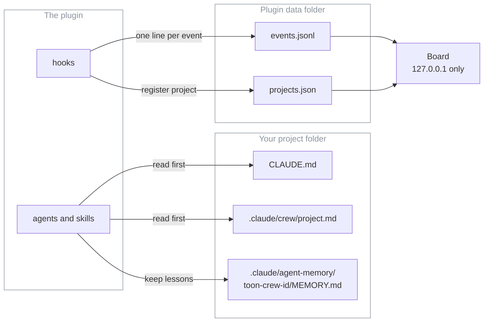
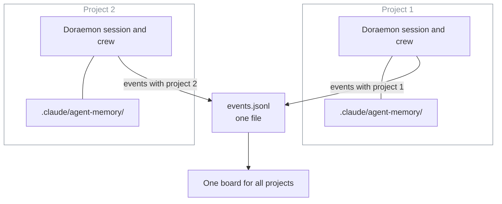
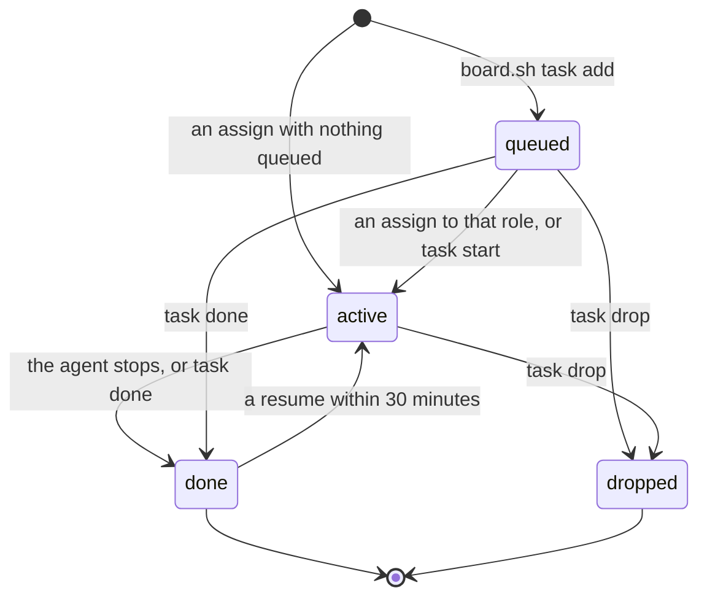

# How the toon crew works

For the owner, and for anyone who has installed the `toon-crew` plugin. After reading this you can follow a piece of work from your request to a merged pull request, and know where the crew keeps its notes.

## 1. The flow

Doraemon is the main agent. You talk to him; he talks to everyone else. Follow the numbers from top to bottom. The right-hand lane shows what the board records at each step.

```mermaid
flowchart TD
    S1["(1) You ask<br/>for something"]
    S2["(2) Doraemon (manager)<br/>reads project.md<br/>and his memory"]
    S3["(3) He plans waves and<br/>gives every task<br/>P0, P1 or P2"]
    S4["(4) He queues each task<br/>on the board<br/>(toon-crew:task)"]
    S5["(5) He writes the contract<br/>and commits it"]
    S6["(6) He briefs the crew,<br/>2 to 4 at a time"]

    subgraph CREW["(7) The crew works"]
        B["Builders, each in<br/>their own worktree<br/>kevin: backend lead<br/>bob: backend developer<br/>shinchan: frontend<br/>mike-wazowski: DevOps<br/>sulley: SRE"]
        R["Reviewers<br/>nobita: UX and design<br/>ninja-hattori: security"]
        T["Testers<br/>joe-gardner: QA<br/>twenty-two: exploratory"]
        RS["Research<br/>dekisugi: research lead<br/>olaf: analyst"]
        D["Docs<br/>shizuka: technical writer"]
        L["Lookups<br/>stuart: code search"]
        B ~~~ RS
        R ~~~ D
        T ~~~ L
    end

    S8["(8) The crew hand back<br/>(a short report each)"]
    S9{"(9) Doraemon verifies:<br/>runs the tests,<br/>reads the diffs"}
    S10["(10) He commits the work<br/>(only he commits)"]
    S11["(11) He adds lessons to<br/>that agent's memory"]
    S12["(12) He opens a draft PR<br/>and tells you the branch<br/>and PR number"]
    S13{"(13) CI checks<br/>all green?"}
    S14{"(14) You say OK?"}
    S15["(15) Mike Wazowski merges<br/>(Sulley for a production<br/>rollout) after your confirm"]
    FIX["Back to step (6)<br/>with a fix brief<br/>(the loop repeats)"]
    S16["(16) Release and deploy,<br/>if the project's rules<br/>say a merge does it"]

    S1 --> S2 --> S3 --> S4 --> S5 --> S6 --> CREW --> S8 --> S9
    S9 -->|"fails"| FIX
    S9 -->|"passes"| S10 --> S11 --> S12 --> S13
    S13 -->|"a check fails"| FIX
    S13 -->|"green"| S14
    S14 -->|"changes wanted"| FIX
    S14 -->|"yes"| S15 --> S16

    K1["Task queued<br/>(Queued list)"]
    K2["Assign: the task<br/>goes Active"]
    K3["Hand-back: the task<br/>is done"]
    K4["Commit logged"]
    K5["PR opened"]
    K6["PR merged"]

    S4 -.->|"board.sh task add"| K1
    S6 -.->|"hook"| K2
    S8 -.->|"hook"| K3
    S10 -.->|"hook"| K4
    S12 -.->|"hook"| K5
    S15 -.->|"hook"| K6

    classDef you fill:#57606a,stroke:#57606a,color:#ffffff
    classDef mgr fill:#1f6feb,stroke:#1f6feb,color:#ffffff
    classDef crew fill:#1a7f37,stroke:#1a7f37,color:#ffffff
    classDef gate fill:#8250df,stroke:#8250df,color:#ffffff
    classDef ops fill:#bc4c00,stroke:#bc4c00,color:#ffffff
    classDef fix fill:#cf222e,stroke:#cf222e,color:#ffffff
    classDef board fill:#0e7490,stroke:#0e7490,color:#ffffff
    class S1 you
    class S2,S3,S4,S5,S6,S8,S10,S11,S12 mgr
    class B,R,T,RS,D,L crew
    class S9,S13,S14 gate
    class FIX fix
    class S15,S16 ops
    class K1,K2,K3,K4,K5,K6 board
    style CREW fill:transparent,stroke:#8b949e,color:#8b949e
```



Colours: grey is you, blue is Doraemon's own work, green is the crew, purple is a check, orange is the DevOps team, red is the loop back, teal is the board. The dotted lines are the board's feed. "Hook" means the plugin's hooks write one line to the event log; the board reads it (section 3 says how). Step 4 is not a hook: `board.sh task add` writes the queued task itself.

What to know:
- **P0, P1, P2.** P0 blocks a release or the critical path. P1 is important next. P2 is nice to have. Doraemon gives every task one.
- **Assigned by skill, not by who is free.** If the right role is busy, the task waits, or a second copy of the same role takes it on different files.
- **Only Doraemon commits.** Builders leave their changes uncommitted in the worktree and name it in the hand-back. Doraemon reviews the diff, brings it into the working branch and commits it. He checks the memory notes for secrets and commits them with the work.
- **Only Doraemon starts crew agents.** Dekisugi may start `toon-crew:olaf` or `toon-crew:stuart` for narrow questions. The guard refuses every other case.
- **Nobody merges without you.** Only Mike Wazowski and Sulley may merge, and only a pull request you approved. The guard asks you to confirm each merge. You can always merge yourself on GitHub.
- **What step 16 means depends on the project.** The plugin does not deploy anything. If a project's `project.md` says a merge to `main` releases and deploys, that happens after step 15; Sulley handles production rollouts and rollbacks.
- **Reviewers and testers.** Nobita and Ninja Hattori review, Joe Gardner and Twenty-Two test; none of them edits your code. Doraemon briefs them in step 6 like any other role.

Words used here:
- **Crew**: the agents in this plugin. Each has one job. Call them as `toon-crew:<id>`.
- **Wave**: a group of tasks that can run at the same time because no two of them touch the same file.
- **Hand-back**: the report an agent gives when it finishes.
- **Worktree**: a separate copy of the repo on disk, so a builder cannot disturb your working folder.
- **Board**: the local status page. It shows who is doing what.

Sections 4, 5 and 6 describe **board v2**: the project picker, the Active and Queued lists and `board.sh task`. It is built (the contract is `docs/planning/board-v2-contract.md`), but it needs plugin version 0.3.0 or later. To check your install, run `board.sh task list`: an older plugin prints a usage line and exits with an error instead of a list.

Sources: `plugin/agents/doraemon.md` ("When invoked", "Assigning work", "Worktrees", "Verifying hand-backs", "Committing and PRs", "Memory duty"), `plugin/skills/task/SKILL.md`, `plugin/board/hook.ts:30-45` (commit and PR events), `docs/roster.md` ("Safety by design").


## 2. Teams and roles

Fifteen agents in nine teams. The model tier is the `model` in each agent file.

| Team | Id | Role | Model |
|---|---|---|---|
| Management | `doraemon` | Engineering Manager: plans, briefs, verifies, commits, opens PRs | opus |
| Management | `miguel-rivera` | Knowledge Manager: weekly lessons pass | sonnet |
| Frontend | `nobita` | UX & Design Lead: journey reviews, design direction (review only) | opus |
| Frontend | `shinchan` | Frontend Developer: screens to a design | sonnet |
| Backend | `kevin` | Backend Lead: data, auth, secrets, APIs, integrations, background jobs | opus |
| Backend | `bob` | Backend Developer: modules and routes from a spec | sonnet |
| DevOps | `mike-wazowski` | DevOps Engineer: CI, builds, Docker, local stack; carries out merges | sonnet |
| DevOps | `sulley` | SRE: deploys, rollouts, rollbacks, backups, incidents; carries out merges | sonnet |
| Security | `ninja-hattori` | Security Engineer: attack-style reviews with proof tests (review only) | opus |
| QA | `joe-gardner` | QA Engineer: runs every check, exact counts | haiku |
| QA | `twenty-two` | Exploratory Tester: odd paths, exact repro steps | sonnet |
| Research | `dekisugi` | Research Lead: cited, dated recommendations | opus |
| Research | `olaf` | Research Analyst: evidence tables, fact-checks | sonnet |
| Documentation | `shizuka` | Technical Writer: docs, release notes, proofreading | sonnet |
| Helpers | `stuart` | Code Search Assistant: read-only lookups answered with path:line | haiku |

Good to know:
- **Own worktree:** kevin, bob, shinchan, mike-wazowski, sulley.
- **Read-only roles** (the guard blocks edits to your code): ninja-hattori, joe-gardner, twenty-two, nobita, dekisugi, olaf, stuart. They write only to their own memory file, temporary folders and, for some, a docs folder.
- **Escalation.** Doraemon passes no model when he starts an agent, except `opus` for one run: sulley on production rollout or rollback design, shizuka on launch, trust or privacy copy, and any role after two failed reviews.

More detail (colours, retired characters, the memory folder move from old names): [roster.md](roster.md).

## 3. Where things live



| What | Where | Who uses it |
|---|---|---|
| Project facts: commands, docs per role, no-go areas, deploy rules | `.claude/crew/project.md` (written by the `project-profile` skill) | Every agent reads it first, with `CLAUDE.md` |
| Memory: lessons for this project, one folder per agent | `.claude/agent-memory/toon-crew-<id>/MEMORY.md`, checked into the project | The agent reads it at the start; Doraemon adds lessons from each hand-back |
| The event log: starts, finishes, assignments, commits, PRs | `events.jsonl` in `$CLAUDE_PLUGIN_DATA` (`~/.toon-crew` if the board is started by hand) | Written by the plugin's hooks; read by the board |
| The project list | `projects.json` in the same folder: path, name, first and last seen | Written when a session starts; read by the board and the weekly lessons pass |
| The board | a local page on `127.0.0.1`, started with the `board` skill | You |

How the hooks work:
- A session start, a subagent start or stop, a Bash, Agent or SendMessage call, and a turn end each send one small message to `board/hook.ts`. It appends at most one line to `events.jsonl`.
- The hooks run in the background (`async`), so they cannot slow a session. They add no model tokens.
- Log lines are short and redacted. An assignment keeps only the task's short description, never the full prompt, and a hand-back is cut to 160 characters.
- A separate hook, the guard (`guard.mjs`), checks every risky call before it runs. It is a seatbelt, not a sandbox: the README's "Guards" section lists what it blocks.
- The board starts with `/toon-crew:board`. Polling a project's CI, PRs or deploys is off until you run `/toon-crew:project board on` in that project, and needs a `## Board` section in its `project.md`.

Sources: `plugin/hooks/hooks.json`, `plugin/board/hook.ts`, `plugin/board/lib/paths.ts`, `plugin/board/README.md`, `plugin/skills/{board,project}/SKILL.md`.

## 4. Several projects

Each project runs its own crew. Doraemon in project 1 and Doraemon in project 2 are separate sessions with separate memory. They never share work.



- The plugin and the board are installed once. Memory, `project.md` and sessions belong to each project.
- Every event the hooks write carries the project name, so the board can tell them apart.
- The only thing that crosses projects is a lesson: with `/toon-crew:project lessons on`, the weekly lessons pass reads a project's memory. Only rules tagged `[crew]` move up, and only through a pull request you review. `[project]` facts stay in their project.
- **The project picker.** Under the tab bar sits a row of chips labelled PROJECT: one chip per project, then **All projects**. The picked chip is solid; the others are dashed. Every chip shows how many tasks are active in that project ("2 active"). One click switches, and the page address gets `?project=<name>`. The pick applies to both tabs (section 6): the Active and Queued panels, the Crew Room's desks and counts, and the Live tab's log, deploys, CI and errors. With **All projects**, each task row also names its project.
- **Which project is picked first.** In this order: the `?project=` value in the page address, the project you picked last time (the page keeps it in your browser), the project with the newest event, then **All projects**. While the page stays open it keeps your pick.

Sources: `plugin/board/README.md`, `plugin/skills/crew-lessons/SKILL.md`, `plugin/board/room.js:313-350` (picker order, chips, address) as of the branch's working copy, `plugin/board/lib/state.ts:27` (newest event).
<!-- TODO(verify): re-check the room.js line numbers and the chip styles (room.css .pchip) against the final build before commit -->

## 5. Active and queued tasks

A task is one piece of work for one role in one project. The board works it out from the event log; nothing else is stored.



The commands (run them as shown in section 6):

```bash
board.sh task add --role <id> [--priority P0|P1|P2] [--ref <branch|PR>] "<text>"
board.sh task start <id>
board.sh task done <id> [--ref <branch|PR>]
board.sh task drop <id>
board.sh task list [--all] [--json]
```

- **Queued.** `add` prints `queued t-<number>-<hex>`; that is the task id. The role must be one of the 15 crew ids, or `add` refuses and lists them. `--priority` is optional; any other value is refused. The text is one line: extra spaces are folded, secrets are redacted, then it is cut to 120 characters. A longer text is cut, not refused. `--ref` (a branch or PR) is cut to 80.
- **Active.** An assign (Doraemon starting that role in that project) takes the **oldest** queued task for that role and project, whatever its priority. If nothing is queued, the assign itself becomes an active task, with its short description as the text and no priority. `task start <id>` does the same for one queued task by hand.
- **Done.** The role's stop event finishes the oldest active task for that role in that project. `task done <id>` does it by hand, for a queued or an active task.
- **Dropped.** `task drop <id>` works on a queued or an active task and hides it. `task start` works only on a queued task. A task that is already done or dropped is refused with "is already done" (or "dropped"), and an unknown id with "no task".
- **Resume.** A message to an existing agent (SendMessage) does not make a new task. If that role finished a task in the same project within the last 30 minutes, the latest one goes back to active. Otherwise nothing changes.
- **Late assign.** An assign that arrives within 5 seconds after the same role stopped in the same project is ignored, unless that role started again in between. A foreground agent call reports its assign just after the agent has stopped; without this rule it would show as a second task.
- **Order.** Active tasks are oldest first. Queued tasks are by priority (P0, P1, P2, then none), then oldest first. The board keeps the last 10 done tasks, newest first.
- **Where you see them.** Both tabs show the Active and Queued panels. The done tasks are in `board.sh task list` and in `/api/state`; the page lists no done tasks. The Live tab's Agent log shows the finish as a "done" line (section 6).
- **Model override.** An active task shows `model override: <name>` when the call asked for a model that differs from the agent file's.

Sources: `plugin/board/task.ts:34-74` (commands, refusals), `plugin/board/lib/tasks.ts:17-27` (priorities, 120 characters, 10 done, 30 minutes, 5 seconds), `tasks.ts:34-82` (states and rules), `tasks.ts:84-93` (order). Checked by running `board.sh task add|list|start|done|drop` against a throwaway data folder: the 150-character text came back as 120, `P9` and an unknown role were refused, and a second `start` or `done` said "already".

## 6. Using the board

Start it once; one board serves every project:

- Type `/toon-crew:board` (it takes `start`, `stop` or `status`; the default is `start`). It prints `{"pid":..,"port":..}`. Open `http://127.0.0.1:<port>`. The port is the first free one from 8811. The skill is set so that only you can run it (`disable-model-invocation: true`).
- Without the skill, run the command it runs: `CLAUDE_PLUGIN_DATA="${CLAUDE_PLUGIN_DATA}" bash "${CLAUDE_PLUGIN_ROOT}/board/board.sh" start`. Use the same data folder as the hooks, or the board shows nothing.

The page has two tabs, **Live** and **Crew Room**, and the page remembers which one you used last (`#room` in the address opens the Crew Room). Both tabs share the project picker (section 4) and the **Active** and **Queued** panels (section 5), so they always show the same tasks. The Live tab refreshes every 4 seconds; the Crew Room every 2 seconds, so its walks follow events closely. The Live tab's header says "Live" with the time, or "Server not answering; retrying…" if the board has stopped; the last data stays on screen.

### The Crew Room tab

A pixel-art office with a desk for each crew member, in rooms by team. It is the quick, friendly view: who is at work, who is free, and what just happened.

- **Header.** A row of counts for the picked project: Working and Queued (the same numbers as the panels), the live version, and the branch. The **Motion** button (MOTION ON or MOTION OFF) turns the animation on or off. Without a choice from you, it follows your device's reduced-motion setting, and the page remembers your choice.
- **Desks.** A character at a desk shows who is working, idle or done. A character working for another project than the one you picked is dimmed.
- **Walkers and bubbles.** When Doraemon starts a role on a task, he walks the corridor to that desk with the task on a piece of paper, says its text in a speech bubble, and the role starts work. When a role hands back, it walks to Doraemon's desk with the result. Doraemon also looks in on someone who has worked for a while without contact. At most two characters walk at once. With Motion off, the same events show as short notes on the desks, with no walking.
- **Hover cards.** Hover over a desk (or focus it with the keyboard, or tap it) to open a small card: the role and team, how long it has been working or since it finished, its task, the model it runs on, and its last hand-back. Press Esc or click elsewhere to close it.
- **The wall.** "On the wall" shows framed pictures of the characters who left the crew, each with a plate saying who took over their job (see [roster.md](roster.md)).

### The Live tab

The plain, text view. Below the picker and the Active and Queued panels:

| Section | What it shows |
|---|---|
| **Crew** | One chip per role: "free", or "N active" with how long the current task has run, plus the number queued. |
| **Agent log** | Starts, finishes, assigns and task changes, newest first, in India time. The page says nothing is logged yet when the log is empty. |
| **Deploys and CI** | For the picked project: the last deploy (version, "ok" or "failed", time), recent CI runs, pull requests and the latest commits. |
| **App errors** | Warnings and errors from the project's api and worker logs, redacted. |

Deploys, CI and app errors need polling, which the owner turns on per project (section 3). Without it those sections say nothing has been read yet. A pull request opened, merged, closed or reopened with `gh pr` in a session is logged by the hooks without polling (`plugin/board/hook.ts:38-46`).

**How a task gets queued.** Doraemon (or you) runs `board.sh task add`. The task shows under Queued for that role. When Doraemon next starts that role in the same project, the oldest queued task for it moves to Active, and the role's hand-back finishes it. Example:

```bash
board.sh task add --role kevin --priority P1 "Add the refunds table"
```

It prints `queued t-<number>-<hex>`. Here `board.sh` stands for `bash "${CLAUDE_PLUGIN_ROOT}/board/board.sh"`, run with `CLAUDE_PLUGIN_DATA` set to the hooks' data folder: with another folder the task goes into a different log and the board never sees it. The project is the registered name of `CLAUDE_PROJECT_DIR`, else the current folder's name, so run it from the project it is for. `board.sh task list` shows the queue for that project, and `--all` shows every project.

Two things to know:
- Tasks are optional. A role started with nothing queued still shows under Active, so the board works without anyone running `task add`.
- Doraemon queues each planned piece with the `toon-crew:task` skill, which runs `board.sh task ...` for him (`plugin/agents/doraemon.md:17`, `plugin/skills/task/SKILL.md`). You can still add tasks yourself with `board.sh task add`.

Sources: `plugin/skills/board/SKILL.md` (the skill, `disable-model-invocation: true`), `plugin/board/board.sh:20-35`, `plugin/board/README.md` ("Start it", "Tasks"), and, in the branch's working copy of the page, `plugin/board/page.html` (tabs, Live sections) and `plugin/board/room.js`: tab memory and `#room` (`:495-503`), refresh rate (`tick`/`loop` in `page.html`), Motion (`:505-510`, `:800`), walkers (`:540-600`, "at most 2"), hover card (`:763-799`), wall (`rRenderGallery`), picker and panels (`:313-366`).
<!-- TODO(verify): re-check every room.js line number and the description of walkers, bubbles, hover cards and the wall against Shinchan's final build before commit -->

## 7. Cost in three lines

- The manager is the cost: Doraemon runs on Opus and was 76 to 99 percent of each measured run, so he delegates reading and searching, keeps turns short and sends lookups to Stuart.
- Cheapest model that fits: Opus where a wrong answer looks right (judgement, design review, security), Sonnet for building and writing, Haiku for checks and lookups.
- Nobody passes a `model` on a call except the listed escalations, because a per-call model beats the agent file. The board shows `model override: <name>` on the task's row when one does.

Figures and how they were measured: [cost-baseline.md](cost-baseline.md) (taken before the cast v2 renames and not re-measured since). Keep waves 2 to 4 wide: many agents cost many times the tokens of one chat.

## FAQ

**Do I have to run the board?**
No. The hooks write the log whether or not the board is running. The board only reads it.

**Why can a read-only agent still write a file?**
Turning on memory re-adds Write to an agent's tools. The guard is the lock: read-only roles can write only their own memory file, temp folders and their deliverable folders. See "Guards" in the [README](../README.md).

**Can the crew merge to main on its own?**
No. Only Mike Wazowski and Sulley may merge, only a pull request you approved, and the guard asks you to confirm each merge. Pushes to `main` ask you too.

**Does the crew in one project learn from another?**
Not directly. Memory stays in each project. If you turn on `lessons`, a weekly pull request to this repo can carry rules that hold in any project, and you decide what to merge.

**My builder's worktree started from the wrong branch.**
Add `"worktree": { "baseRef": "head" }` to the project's `.claude/settings.json`. Plugin settings cannot set it, and the guard stops the crew editing that file, so make the edit yourself. See "Per-project setup" in the [README](../README.md).
